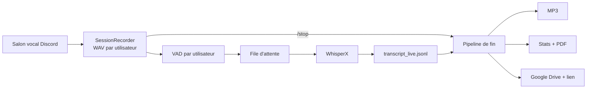

<div align="center">

# 🎙️ Discord Voice Recorder

**Un bot Discord qui enregistre un salon vocal, transcrit en quasi temps réel avec WhisperX,
puis livre MP3, transcript, rapport PDF et lien de partage Google Drive.**


</div>

---

## ✨ Fonctionnalités

- **Un fichier audio par participant**, écrit au fil de l'eau (WAV 16 kHz mono, lisible même pendant l'enregistrement) ; tous les fichiers partagent la même timeline.
- **Transcription quasi temps réel** : détection de voix (VAD) par utilisateur, découpage en énoncés, envoi à WhisperX, timestamps début/fin cohérents avec la session.
- **Anti-hallucinations** : garde-fou de niveau sonore + filtre de phrases fantômes (« Sous-titrage… »). Les segments rejetés sont conservés dans un fichier à part.
- **Surveillance de la file d'attente** ASR (barre dans la console et dans `/status`) pour voir si WhisperX prend du retard.
- **Fin de session automatisée** : MP3, statistiques (et palmarès amusant), rapport PDF, dépôt sur Google Drive, lien de partage. Chaque étape est **activable ou non** et son statut s'affiche dans le chat.
- **Tout est configurable** dans un seul `config.ini`, modifiable aussi depuis Discord avec `/config`.
- **Aucun message de transcription publié automatiquement** : `/transcript` affiche les derniers échanges, à la demande, pour tout le monde.
- Architecture modulaire (un fichier par composant) et suite de tests sans GPU ni connexion.

## 🧭 Fonctionnement



## 📦 Prérequis

| Élément | Installé par `install.bat` ? | Remarque |
|---|---|---|
| **conda** (Miniconda, Anaconda ou Miniforge) | ❌ **à installer avant** | [Miniconda](https://www.anaconda.com/docs/getting-started/miniconda/install) ou [Miniforge](https://github.com/conda-forge/miniforge) |
| Python 3.12 | ✅ dans l'environnement conda | WhisperX n'accepte pas Python 3.14 : l'environnement est indépendant de votre Python système |
| ffmpeg | ✅ dans l'environnement conda | nécessaire pour les MP3 |
| Git | ✅ dans l'environnement conda | nécessaire pour le fork de `discord-ext-voice-recv` |
| PyTorch (CPU ou GPU) | ✅ automatique | variante choisie selon `nvidia-smi` |
| Dépendances Python | ✅ automatique | `requirements.txt` |
| Pilote NVIDIA à jour | ❌ manuel | pour utiliser le GPU |
| CUDA Toolkit 12.8 | ❌ manuel, parfois utile | recommandé par WhisperX pour le GPU ; si cuDNN/ctranslate2 se plaint |
| Application Discord + token | ❌ manuel | voir ci-dessous |
| Identifiants Google (`credentials.json`) | ❌ manuel, optionnel | seulement pour l'envoi sur Drive |

## 🚀 Installation rapide (Windows)

```bat
git clone https://github.com/<vous>/discord-voice-recorder.git
cd discord-voice-recorder
install.bat
```

`install.bat` accepte deux arguments facultatifs : `install.bat [auto|cpu|cu126|cu128] [nom_env]`. Le premier force la variante de PyTorch (défaut `auto`), le second change le nom de l'environnement conda (défaut `voicerecorder`).

Il : 1) localise conda, 2) crée l'environnement (Python 3.12 + ffmpeg + git, canal conda-forge), 3) installe PyTorch, 4) installe `requirements.txt`, 5) lance un diagnostic (`tools/check_env.py`).

> Lancez-le depuis un terminal normal ou « Anaconda Prompt » : conda est retrouvé automatiquement, même s'il n'est pas dans le PATH, dans ses dossiers d'installation habituels. Relancer `install.bat` est sans risque : l'environnement existant est réutilisé.

### Et PyTorch ?

Oui, c'est automatisé. Sur Windows, `pip install torch` depuis PyPI donne une version **CPU uniquement**. `tools/install_torch.py` lit la version CUDA supportée par votre pilote (`nvidia-smi`) et installe le bon build depuis l'index PyTorch :

| CUDA du pilote | Build installé |
|---|---|
| ≥ 12.8 (ou 13.x) | `cu128` |
| 12.6 – 12.7 | `cu126` |
| plus ancien / pas de GPU | `cpu` |

Version épinglée : `torch==2.8.*` (exigée par WhisperX). Pour voir la commande sans l'exécuter : `python tools/install_torch.py --dry-run`.

## 🔧 Étapes manuelles

### 1. Créer le bot Discord

1. [Discord Developer Portal](https://discord.com/developers/applications) → *New Application* → onglet **Bot** → *Reset Token* et copiez le token.
2. Aucun intent privilégié n'est nécessaire.
3. **OAuth2 → URL Generator** : scopes `bot` et `applications.commands` ; permissions *View Channels*, *Send Messages*, *Embed Links*, *Connect*. Ouvrez l'URL générée pour inviter le bot.

### 2. Fournir le token

```bat
setx DISCORD_TOKEN "votre_token"
```

(puis nouveau terminal) — ou renseignez `token` dans la section `[discord]` de `config.ini`. Ne commitez jamais ce fichier (il est dans `.gitignore`).

### 3. Google Drive (optionnel)

1. [Google Cloud Console](https://console.cloud.google.com/) : créez un projet, activez **Google Drive API**.
2. *Écran de consentement OAuth* : ajoutez votre compte comme **utilisateur test**.
3. *Identifiants* → *ID client OAuth* de type **Application de bureau** → téléchargez le JSON et enregistrez-le sous `credentials.json` à la racine.
4. Au premier lancement, une fenêtre de navigateur demande l'autorisation ; `token.json` est créé.

En mode « Test », le jeton expire au bout de 7 jours : supprimez `token.json` et relancez pour ré-autoriser.

Sans `credentials.json`, le bot fonctionne normalement : l'étape Drive est simplement signalée comme indisponible.

### 4. Lancer

```bat
run.bat
```

Le modèle Whisper se charge dès le démarrage (état visible dans la console et dans le statut du bot). Lancez ensuite `/record` depuis un salon texte, en étant connecté à un salon vocal.

## 🕹️ Commandes

| Commande | Rôle |
|---|---|
| `/record` | Rejoint votre salon vocal et démarre l'enregistrement (avec message de consentement) |
| `/stop` | Arrête et lance le traitement de fin de session |
| `/transcript [nombre]` | Affiche les derniers messages transcrits, visibles de tous |
| `/stats` | Statistiques de la session en cours |
| `/status` | État de Whisper, de Drive et de la file d'attente |
| `/config` | Affiche/modifie les étapes de fin de session (permission *Gérer le serveur*) |

> Les commandes n'apparaissent parfois qu'après un rafraîchissement du client Discord (**Ctrl+R**). Pour une synchronisation instantanée, renseignez l'identifiant de votre serveur dans `[discord]` (`guild_id`).

## ⚙️ Configuration

Au premier lancement, `config.ini` est créé avec les valeurs par défaut et tous les commentaires ([`config.example.ini`](config.example.ini) en est une copie). Les clés manquantes sont ajoutées automatiquement ; une valeur invalide retombe sur le défaut avec un avertissement.

| Section | Contenu |
|---|---|
| `[discord]` | token, serveur de synchronisation |
| `[sessions]` | dossier de sortie |
| `[audio]` | tolérance de gigue, rythme d'écriture |
| `[vad]` | agressivité, pré-roll, silence de fin, durée max, **`niveau_min_dbfs`** |
| `[whisper]` | modèle, device, type de calcul, langue, filtre d'hallucinations |
| `[live]` | rafraîchissement de la console, seuil d'alerte de file |
| `[stats]` | palmarès, mots exclus |
| `[rapport]` | options du PDF |
| `[fin_de_session]` | étapes activées : `mp3`, `rapport`, `drive`, `drive_audio`, `partage` |
| `[mp3]` | débit, chemin de ffmpeg |
| `[drive]` | identifiants, jeton, dossier racine |

Les étapes de `[fin_de_session]` sont relues à chaque `/stop`, sans redémarrer.

## 📁 Résultat d'une session

```
sessions/2026-10-30_120000/
├── meta.json                       # participants, durée
├── audio/                          # un WAV par utilisateur
├── audio_mp3/                      # MP3 (si activé)
├── transcript_live.jsonl           # brut, temps réel
├── transcript_live.txt             # transcript final trié, horodaté
├── transcript_live_rejected.jsonl  # segments écartés (hallucinations, trop faibles)
├── stats.json / stats.txt
└── rapport.pdf
```

## 🩺 Dépannage

| Symptôme | Piste |
|---|---|
| `/record` sans effet | Ctrl+R dans Discord ; vérifier les permissions du bot |
| Pas de réception audio (DAVE) | `discord-ext-voice-recv` sur PyPI ne gère pas DAVE : `requirements.txt` utilise un fork épinglé |
| Textes fantômes sur des silences | augmenter `niveau_min_dbfs` (ex. `-40`) ; à l'inverse, le baisser (ex. `-55`) rend plus permissif |
| Transcription qui prend du retard | modèle plus petit (`small` → `base`), `calcul = int8`, ou GPU |
| GPU non utilisé | `python tools/check_env.py` ; relancer `install.bat cu128` ; mettre à jour le pilote |
| Erreur cuDNN / ctranslate2 | installer le CUDA Toolkit 12.8 |
| Drive : *403 access_denied* | ajouter votre compte comme utilisateur test, bon compte, API activée |
| MP3 en échec | ffmpeg introuvable : l'installer ou renseigner `[mp3] ffmpeg` |

`python tools/check_env.py` produit un diagnostic complet de l'environnement.

## ⚖️ Vie privée et consentement

Le bot enregistre la voix de personnes identifiables et en conserve la transcription. Informez les participants, obtenez leur accord et respectez la réglementation applicable (RGPD en Europe, règles de Discord). `/record` publie un message d'information dans le salon ; le partage Drive par lien rend les fichiers accessibles à quiconque possède le lien — désactivez `partage` si besoin.

## 🛠️ Développement

```bash
conda create -n voicerecorder -c conda-forge python=3.12 ffmpeg git -y
conda activate voicerecorder
pip install -r requirements-dev.txt
python -m pytest
```

Les tests utilisent des doublures de Discord, torch et WhisperX : aucun GPU, token ni réseau requis. L'intégration continue (`.github/workflows/tests.yml`) les exécute à chaque push.

```
install.bat / run.bat / _conda.bat   # installation et lancement (conda)
bot_v4.py            # point d'entrée (le numéro suit la version du programme)
voicebot/
├── config.py        # config.ini : lecture, validation, édition
├── audio.py         # réception, WAV par utilisateur
├── vad.py           # détection de voix
├── whisper_engine.py# chargement et appel WhisperX
├── live.py          # transcription temps réel, anti-hallucinations
├── transcript.py    # transcript final
├── stats.py         # statistiques et palmarès
├── report.py        # PDF
├── mp3.py           # conversion ffmpeg
├── drive.py         # Google Drive
├── pipeline.py      # étapes de fin de session + statut dans le chat
├── client.py        # client Discord, statut
└── commands.py      # commandes slash
tools/               # install_torch, check_env, make_config_example
```

Après toute modification des paramètres : `python tools/make_config_example.py` (un test vérifie que `config.example.ini` est à jour).

## 📄 Licence

Aucune licence n'est encore définie : ajoutez un fichier `LICENSE` de votre choix avant de publier.
