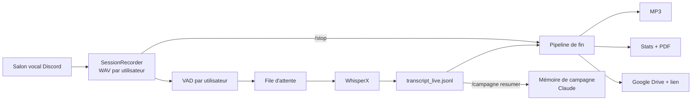

<div align="center">

# 🎙️ Discord Voice Recorder

**Un bot Discord qui enregistre un salon vocal, transcrit en quasi temps réel avec WhisperX,
puis livre MP3, transcript, rapport PDF et lien de partage Google Drive.**


</div>

---

## ✨ Fonctionnalités

- **Un fichier audio par participant**, écrit au fil de l'eau (WAV 16 kHz mono, lisible même pendant l'enregistrement) ; tous les fichiers partagent la même timeline.
- **Transcription quasi temps réel** : détection de voix (VAD) par utilisateur, découpage en énoncés, envoi à WhisperX, timestamps début/fin cohérents avec la session.
- **Anti-hallucinations** : garde-fou de niveau sonore + filtre de phrases fantômes (« Sous-titrage… »). Les segments rejetés sont conservés dans un fichier à part.
- **Surveillance de la file d'attente** ASR (barre dans la console et dans `/status`) pour voir si WhisperX prend du retard.
- **Fin de session automatisée** : MP3, statistiques (et palmarès amusant), rapport PDF, dépôt sur Google Drive, lien de partage. Chaque étape est **activable ou non** et son statut s'affiche dans le chat.
- **Tout est configurable** dans un seul `config.ini`, modifiable aussi depuis Discord avec `/config`.
- **Arbitrage de règles** : `/regle` envoie les dernières phrases à Google Gemini, qui explique ou précise le point de règle évoqué (jeu au choix, Pathfinder première édition par défaut).
- **Mémoire de campagne** (jeu de rôle) : `/campagne resumer` fait rédiger par Claude le compte rendu, le résumé global et le « Dans l'épisode précédent… », que le bot peut lire à voix haute au début de la séance suivante.
- **Aucun message de transcription publié automatiquement** : `/transcript` affiche les derniers échanges, à la demande, pour tout le monde.
- Architecture modulaire (un fichier par composant) et suite de tests sans GPU ni connexion.

## 🧭 Fonctionnement



## 📦 Prérequis

| Élément | Installé par `install.bat` ? | Remarque |
|---|---|---|
| **conda** (Miniconda, Anaconda ou Miniforge) | ❌ **à installer avant** | [Miniconda](https://www.anaconda.com/docs/getting-started/miniconda/install) ou [Miniforge](https://github.com/conda-forge/miniforge) |
| Python 3.12 | ✅ dans l'environnement conda | WhisperX n'accepte pas Python 3.14 : l'environnement est indépendant de votre Python système |
| ffmpeg | ✅ dans l'environnement conda | nécessaire pour les MP3 |
| Git | ✅ dans l'environnement conda | nécessaire pour le fork de `discord-ext-voice-recv` |
| PyTorch (CPU ou GPU) | ✅ automatique | variante choisie selon `nvidia-smi` |
| Dépendances Python | ✅ automatique | `requirements.txt` |
| Pilote NVIDIA à jour | ❌ manuel | pour utiliser le GPU |
| CUDA Toolkit 12.8 | ❌ manuel, parfois utile | recommandé par WhisperX pour le GPU ; si cuDNN/ctranslate2 se plaint |
| Application Discord + token | ❌ manuel | voir ci-dessous |
| Claude Code (`claude`) | ❌ manuel, optionnel | pour la mémoire de campagne (`/campagne resumer`, `contexte`, `condenser`, `/glossaire corriger`) : utilise votre abonnement, sans clé d'API |
| Clé d'API Gemini | ❌ manuel, optionnel | seulement pour `/regle` |
| Identifiants Google (`credentials.json`) | ❌ manuel, optionnel | seulement pour l'envoi sur Drive |

## 🚀 Installation rapide (Windows)

```bat
git clone https://github.com/<vous>/discord-voice-recorder.git
cd discord-voice-recorder
install.bat
```

`install.bat` accepte deux arguments facultatifs : `install.bat [auto|cpu|cu126|cu128] [nom_env]`. Le premier force la variante de PyTorch (défaut `auto`), le second change le nom de l'environnement conda (défaut `voicerecorder`).

Il : 1) localise conda, 2) crée l'environnement (Python 3.12 + ffmpeg + git, canal conda-forge), 3) installe PyTorch, 4) installe `requirements.txt`, 5) lance un diagnostic (`tools/check_env.py`).

> Lancez-le depuis un terminal normal ou « Anaconda Prompt » : conda est retrouvé automatiquement, même s'il n'est pas dans le PATH, dans ses dossiers d'installation habituels. Relancer `install.bat` est sans risque : l'environnement existant est réutilisé.

### Et PyTorch ?

Oui, c'est automatisé. Sur Windows, `pip install torch` depuis PyPI donne une version **CPU uniquement**. `tools/install_torch.py` lit la version CUDA supportée par votre pilote (`nvidia-smi`) et installe le bon build depuis l'index PyTorch :

| CUDA du pilote | Build installé |
|---|---|
| ≥ 12.8 (ou 13.x) | `cu128` |
| 12.6 – 12.7 | `cu126` |
| plus ancien / pas de GPU | `cpu` |

Si la détection échoue (ou conclut à `cpu`), l'installeur affiche un **menu** pour choisir le build à la main (CPU / CUDA 12.6 / CUDA 12.8 ; Entrée = valeur proposée). Pour ne jamais poser de question, par exemple en automatisation : `python tools/install_torch.py --no-prompt`.

Version épinglée : `torch==2.8.*` (exigée par WhisperX). Pour voir la commande sans l'exécuter : `python tools/install_torch.py --dry-run`.

## 🔧 Étapes manuelles

### 1. Créer le bot Discord

1. [Discord Developer Portal](https://discord.com/developers/applications) → *New Application* → onglet **Bot** → *Reset Token* et copiez le token.
2. Aucun intent privilégié n'est nécessaire.
3. **OAuth2 → URL Generator** : scopes `bot` et `applications.commands` ; permissions *View Channels*, *Send Messages*, *Embed Links*, *Connect*. Ouvrez l'URL générée pour inviter le bot.

### 2. Fournir le token

```bat
setx DISCORD_TOKEN "votre_token"
```

(puis nouveau terminal) — ou renseignez `token` dans la section `[discord]` de `config.ini`. Ne commitez jamais ce fichier (il est dans `.gitignore`).

### 3. Google Drive (optionnel)

1. [Google Cloud Console](https://console.cloud.google.com/) : créez un projet, activez **Google Drive API**.
2. *Écran de consentement OAuth* : ajoutez votre compte comme **utilisateur test**.
3. *Identifiants* → *ID client OAuth* de type **Application de bureau** → téléchargez le JSON et enregistrez-le sous `credentials.json` à la racine.
4. Au premier lancement, une fenêtre de navigateur demande l'autorisation ; `token.json` est créé.

En mode « Test », le jeton expire au bout de 7 jours : supprimez `token.json` et relancez pour ré-autoriser.

Sans `credentials.json`, le bot fonctionne normalement : l'étape Drive est simplement signalée comme indisponible.

### 4. Gemini pour `/regle` (optionnel)

1. Créez une clé sur [Google AI Studio](https://aistudio.google.com/apikey).
2. Définissez-la : `setx GEMINI_API_KEY "votre_cle"` (puis nouveau terminal), ou `cle_api` dans la section `[regles]` de `config.ini`.
3. Sans clé, le bot fonctionne normalement : `/regle` répond simplement qu'elle n'est pas configurée.

Le modèle (`modele`), le niveau de réflexion (`reflexion`, `low` par défaut pour des réponses rapides), la consigne envoyée à Gemini (`instruction`), le jeu par défaut, le nombre de phrases analysées et l'usage de la recherche Google (`recherche_web`) se règlent dans `[regles]`. Les réponses viennent d'un modèle d'IA et d'une transcription automatique : à vérifier dans le livre de règles.

### Un salon dédié aux messages système du bot (optionnel)

Pour ne pas polluer le salon principal : créez un salon texte (ex. `#bot-enregistrements`), activez le mode développeur de Discord (Paramètres → Avancés), faites clic droit sur le salon → *Copier l'identifiant du salon*, puis renseignez-le dans `config.ini` :

```ini
[discord]
canal_messages = 123456789012345678
```

Le bot doit avoir les droits *Voir le salon*, *Envoyer des messages* et *Intégrer des liens* dans ce salon. Il ne reçoit que les messages système et informatifs : suivi du traitement de fin de session, alertes, **une ligne de trace à chaque commande lancée** (`▶️ Nom : /commande paramètres`), compte rendu de `/campagne resumer` et `/campagne condenser`. Les réponses aux demandes (`/regle`, `/transcript`, `/stats`, `/campagne afficher`…) et le message de consentement de `/record` restent dans le salon où la commande est tapée ; `/config` et `/campagne rollback` répondent en privé. Sans salon renseigné, tout reste dans le salon de la commande, sans trace. Si le salon est introuvable ou inaccessible, le bot répond là où la commande a été lancée, avec un avertissement dans la console.

### 5. Claude pour la mémoire de campagne (optionnel)

Installez Claude Code sur la machine du bot, ouvrez un terminal, lancez `claude` puis `/login`. Le bot utilise votre abonnement (aucune clé d'API) pour `/campagne resumer`, `contexte`, `condenser` et `/glossaire corriger`. Sans Claude, ces commandes répondent simplement qu'il est indisponible.

### 6. Lancer

```bat
run.bat
```

Le modèle Whisper se charge dès le démarrage (état visible dans la console et dans le statut du bot). Lancez ensuite `/record` depuis un salon texte, en étant connecté à un salon vocal.

## 🕹️ Commandes

| Commande | Rôle |
|---|---|
| `/record` | Rejoint votre salon vocal et démarre l'enregistrement (avec message de consentement) |
| `/stop` | Arrête et lance le traitement de fin de session |
| `/status` | État de Whisper, de Drive et de la file d'attente |
| `/stats` | Statistiques de la session en cours |
| `/transcript [nombre]` | Affiche les derniers messages transcrits, visibles de tous |
| `/retranscrire [session]` | Refait le transcript d'une session depuis ses fichiers audio complets, avec les réglages actuels (*Gérer le serveur*) |
| `/dicter texte [nom_voix]` | Le bot dit un texte à voix haute dans votre canal vocal et vous envoie l'audio en pièce jointe (*Gérer le serveur*) |
| `/regle [jeu] [phrases] [question] [dicter] [nom_voix]` | Gemini explique la règle évoquée dans les dernières phrases, ou répond à une `question` libre ; `dicter` lit la réponse à voix haute |
| `/config [cle] [valeur]` | Affiche ou modifie les étapes de fin de session (*Gérer le serveur* pour modifier) |
| `/campagne …` | Mémoire de campagne, en sous-commandes : `liste`, `info`, `nouvelle`, `choisir`, `mj`, `joueur`, `contexte`, `journal`, `afficher`, `resumer`, `condenser`, `rollback`, `audio`, `dicter`, `voix` |
| `/glossaire afficher\|corriger\|annuler` | Glossaire appris de la campagne : le consulter, corriger une information fausse, annuler la dernière correction |

Le détail de chaque commande et de ses paramètres est dans [`wiki/Commandes.md`](wiki/Commandes.md).

> Les commandes n'apparaissent parfois qu'après un rafraîchissement du client Discord (**Ctrl+R**). Pour une synchronisation instantanée, renseignez l'identifiant de votre serveur dans `[discord]` (`guild_id`).

## ⚙️ Configuration

Au premier lancement, `config.ini` est créé avec les valeurs par défaut et tous les commentaires ([`config.example.ini`](config.example.ini) en est une copie). Les clés manquantes sont ajoutées automatiquement ; une valeur invalide retombe sur le défaut avec un avertissement ; une clé qui n'existe plus est ignorée. Toutes les clés sont décrites dans [`wiki/Configuration.md`](wiki/Configuration.md).

| Section | Contenu |
|---|---|
| `[discord]` | token, serveur de synchronisation, salon dédié aux messages du bot (`canal_messages`), message de consentement |
| `[modeles]` | dossier des modèles téléchargés (Whisper, alignement, OmniVoice) : `modeles/` dans le dossier du programme par défaut, vide = cache habituel `~/.cache` |
| `[sessions]` | dossier de sortie |
| `[audio]` | tolérance de gigue, rythme d'écriture |
| `[vad]` | agressivité, pré-roll, silence de fin, durée max, **`niveau_min_dbfs`** |
| `[whisper]` | modèle WhisperX, device, type de calcul, langue, filtre d'hallucinations, mots isolés ignorés |
| `[live]` | rafraîchissement de la console, seuil d'alerte de file |
| `[stats]` | palmarès, mots exclus |
| `[rapport]` | options du PDF |
| `[fin_de_session]` | étapes activées : `mp3`, `rapport`, `drive`, `drive_audio`, `partage` |
| `[mp3]` | débit, chemin de ffmpeg |
| `[drive]` | identifiants, jeton, dossier racine |
| `[voix]` | voix du bot (OmniVoice) : activation, lecture au `/record`, dossier des voix, voix par défaut, langue, vitesse |
| `[campagnes]` | dossier des campagnes, tailles maximales des fichiers joints, fusion des répliques envoyées à Claude |
| `[claude]` | programme `claude` de votre abonnement : commande, modèle, effort, délai, nettoyage, questions |
| `[regles]` | accès Gemini (clé, modèle, réflexion) et commande `/regle` : jeu par défaut, nombre de phrases, consigne |

Les étapes de `[fin_de_session]` sont relues à chaque `/stop`, sans redémarrer.

## 📁 Résultat d'une session

```
sessions/2026-10-30_120000/
├── meta.json                       # participants, durée
├── audio/                          # un WAV par utilisateur
├── audio_mp3/                      # MP3 (si activé)
├── transcript_live.jsonl           # brut, temps réel
├── transcript_live.txt             # transcript final trié, horodaté
├── transcript_live_rejected.jsonl  # segments écartés (hallucinations, trop faibles)
├── stats.json / stats.txt
├── avant_retranscription_<date>/   # ancien transcript, après un /retranscrire
└── rapport.pdf
```

### Où sont les modèles ?

Les modèles (Whisper, alignement, voix) sont téléchargés dans `modeles/` à côté du programme (`modeles/huggingface` et `modeles/torch`), et non dans `~/.cache`. Changez ou videz `dossier` dans `[modeles]` pour revenir au cache habituel. Les modèles déjà présents dans `~/.cache/huggingface` ne sont pas déplacés : ils sont retéléchargés (plusieurs Go) ; pour les réutiliser, copiez `~/.cache/huggingface/hub` dans `modeles/huggingface/`. Le changement vaut pour le bot **et** pour les environnements des voix (le bot leur transmet le dossier).

## 📖 Campagnes (`/campagne`)

Chaque campagne a son dossier dans `campagnes/` : `campagne.json`, `joueurs.json` (MJ et joueurs, repérés par **identifiant Discord** puisque les pseudos changent), `contexte.md`, `glossaire.md`, `seances/`, `resume_global/`. La campagne active est celle choisie en dernier. Tout reste en fichiers texte modifiables à la main.

### Créer ou reprendre une campagne

1. Rejoignez le canal vocal puis `/campagne nouvelle nom:Hell's Rebels mj:@quelqu'un` : les membres du canal sont pré-remplis (le MJ n'est jamais déduit ; sans `mj`, utilisez `/campagne mj` plus tard).
2. `/campagne contexte fichier:description.txt` : Claude restructure votre texte (personnages, secrets, glossaire) en `contexte.md` et associe les personnages aux joueurs. **Aucun secret n'est déduit** : sans indication explicite, un fait est marqué `[à confirmer]`. Relisez le résultat.
3. Campagne déjà commencée : `/campagne journal fichier:journal.txt` importe le journal comme version 1 du résumé global, et `/campagne resumer fichier:transcript.txt session:2026-10-24` intègre un transcript existant (formats du bot, entre crochets ou SRT ; `session` donne la date de la séance).

### Résumer une séance : `/campagne resumer`

`/campagne resumer` fait tout en une commande avec le programme officiel **`claude`** (Claude Code) installé sur la machine du bot, **avec ton abonnement** (aucune clé d'API, aucune facturation à l'unité). Rien ne se déclenche seul : ni à la fin de session, ni ailleurs. Un `/campagne rollback` annule le tout (séance, version du résumé et ajouts au glossaire).

Avec les réglages par défaut, la commande enchaîne **trois appels** à Claude, suivis dans un seul message de statut :

1. **Nettoyage.** Claude lit le transcript (lignes numérotées) et renvoie une *liste de corrections* : noms, lieux, termes de règles mal reconnus. Il ne réécrit pas le texte : le bot vérifie chaque correction (la ligne existe, le texte à remplacer y figure vraiment, l'ajout n'est pas démesuré), les applique et écrit `seances/<séance>/analyse/transcript_corrige.txt`, `corrections.md` (appliquées et rejetées, avec le motif) et `bilan.md` (qualité du transcript, passages peu fiables). L'original n'est jamais modifié.
2. **Analyse.** Sur le transcript corrigé, Claude produit les notes, un brouillon du compte rendu, des changements, de la chronologie, des rubriques et du « précédemment », plus **des questions sur les ambiguïtés de scénario** (ce personnage est-il le même que dans l'autre scène ? qui a décidé ça ?), jamais sur la qualité du transcript.
3. **Version finale.** Les questions sont posées dans le salon (un menu par question, « Autre réponse… » pour écrire, « Je ne sais pas / laisser ambigu »). Toute personne avec la permission *Gérer le serveur* peut répondre. Tu peux changer d'avis : rien n'est envoyé à Claude avant le bouton **Valider les réponses**. Ce n'est jamais bloquant : sans validation après `questions_delai_min` (30 min), les réponses données sont utilisées telles quelles, et les questions sans réponse restent « non précisé » dans les « Réserves ». Claude reçoit alors le brouillon, les réponses et les extraits du transcript autour des moments cités, et rédige les documents définitifs, que le bot intègre.

Le **glossaire** (`glossaire.md` dans le dossier de la campagne, modifiable à la main) s'enrichit à la fin : les noms corrigés (seulement les variantes réellement présentes dans le transcript) et les décisions de scénario des joueurs (chacune étiquetée de sa séance, et jamais montrée à Claude quand cette même séance est refaite). Il est ajouté au contexte de tous les résumés suivants.

Chaque appel est mémorisé dans `seances/<séance>/analyse/` : après une erreur (connexion, délai…), relancer `/campagne resumer` reprend sans refaire les appels déjà réussis. Réglages de `[claude]` : `nettoyage` et `questions` (mettre les deux à `non` rend l'ancien mode rapide, un seul appel), `questions_max`, `questions_delai_min`.

**Mise en place (une fois)** : installe Claude Code sur la machine du bot, ouvre un terminal, lance `claude` puis `/login`. Dans `config.ini`, la section `[claude]` règle `modele` (`sonnet` par défaut), `effort` (`medium` par défaut, ~2 min par séance ; `low` est plus rapide mais moins fiable), `delai_s` et `commande` si `claude` n'est pas dans le PATH. Les essais ont montré que Haiku invente des détails et que `medium` est plus fiable que `low`, même si le modèle n'a plus à réécrire tout le résumé.

**Ce que le modèle écrit, et ce que fait le programme** : le modèle ne renvoie que ce qui change (compte rendu, changements, texte de la séance pour la « Chronologie », rubriques modifiées, « précédemment »). C'est le **programme** qui ajoute le paragraphe à la fin de la chronologie existante et ne remplace que les rubriques citées : les anciennes séances ne sont jamais recopiées ni abrégées. Compatible avec les campagnes déjà alimentées : l'ancien résumé reste la base (titres Markdown, lignes en gras, ou texte libre importé avec `journal`) ; si une rubrique « Chronologie » manque, elle est créée à la fin et le bot le signale. Il avertit aussi quand une rubrique remplacée est nettement plus courte que l'ancienne, ou quand le « précédemment » dépasse la longueur visée. L'ancien format de réponse (`=== RESUME GLOBAL ===`) reste accepté par `integrer`.

**Précautions** : `claude` est lancé sans outil, sans serveur MCP, sans plugins ni réglages perso, dans un dossier vide, et `ANTHROPIC_API_KEY` est retirée de son environnement (sinon l'API serait facturée). La transcription est traitée comme une donnée, jamais comme une consigne. Le pack part chez Anthropic : contexte, résumé global et transcript. Relis le résultat au début (secrets `[secret:…]` / `[mj]`), tu as `/campagne afficher` et `rollback`. Un usage individuel, occasionnel, est dans l'esprit de l'abonnement ; ne lance pas la commande en rafale. Si la limite d'usage de ton abonnement est atteinte, le bot l'indique. Pour l'ancienne méthode, `moteur_resume = gemini`.

**Informations « à retenir ».** Si un joueur demande à voix haute de retenir une information (« l'IA, retiens bien ce que vient d'expliquer le MJ »), une consigne demande à Claude de repérer lui-même cette demande, de trouver l'information visée et de la faire figurer dans une rubrique « À retenir » du compte rendu, dans la chronologie et dans les rubriques concernées du résumé global. Le nettoyage du transcript ne supprime jamais ces demandes.

### Corriger le glossaire : `/glossaire`

`/glossaire afficher` montre les entrées. Quand une information apprise s'avère fausse, `/glossaire corriger precision:"Le chef du fort n'est pas Lucien, c'est Thrune"` demande à Claude les opérations à faire (supprimer, remplacer, ajouter) ; un aperçu s'affiche et rien n'est modifié avant le bouton *Appliquer*. `/glossaire annuler` restaure la version précédente (`glossaire_versions/`).

### Condenser le résumé global : `/campagne condenser`

Quand la chronologie s'allonge (un donjon exploré sur plusieurs séances), `/campagne condenser` remplace des séances consécutives par un seul bloc **Chapitre**, et plus tard des chapitres par un **Livre**. Sans `de`/`a`, Claude propose les regroupements ; un aperçu est toujours affiché avant validation. Quand la dernière séance d'un groupe ouvre un nouvel arc, le condensé se termine par une section « Suite » qui sert d'amorce au bloc suivant.

Chaque condensé devient aussi **une séance à part entière** : un dossier `seances/<dernière séance couverte>_chapitre_<titre>/` avec son compte rendu, son « précédemment » et son audio. Les comptes rendus des séances jouées ne sont jamais touchés.

**Quel « précédemment » est lu ?** Toujours celui de la dernière séance de la campagne, réelle ou condensée : si un condensé couvre la dernière séance, c'est le sien ; s'il existe des séances plus récentes, c'est celui de la plus récente.

### Retour en arrière

Chaque mise à jour du résumé global (journal, séance, condensation) crée une nouvelle version `vNNN_*.md`, jamais écrasée. `/campagne rollback` annule la dernière : elle est archivée dans `resume_global/annulees/`, la précédente redevient le résumé actif, et la séance ou les condensés associés sont déplacés dans `seances/_annulees/`. Répétez pour remonter plus loin.

## 🔊 Voix du bot (OmniVoice, optionnelle)

Le bot peut lire à voix haute le « Dans l'épisode précédent… » au démarrage d'un enregistrement, à la demande avec `/campagne dicter`, et n'importe quel texte avec `/dicter`. Le moteur est [OmniVoice](https://github.com/k2-fsa/OmniVoice) (multilingue, code Apache 2.0, **poids du modèle sous licence CC-BY-NC : usage non commercial**). **Voix désactivée par défaut.**

**Le « précédemment » est lu depuis un fichier audio préparé à l'avance** (`seances/<séance>/precedemment.wav`), automatiquement après `/campagne resumer` et `/campagne condenser`, ou avec `/campagne audio`. Deux modes, selon `liberer_whisper` dans `[voix]` :
- **`non` (défaut)** : Whisper reste chargé. La voix fonctionne aussi pendant un enregistrement, mais il faut assez de mémoire GPU pour les deux modèles (la console affiche la mémoire utilisée). Le modèle vocal est chargé une fois au démarrage du bot.
- **`oui`** : pour préparer un audio, le bot libère Whisper de la mémoire, lance le moteur vocal, puis recharge Whisper ; la synthèse est alors refusée pendant un enregistrement, et `/record` pendant une synthèse.

Dans les deux modes, la voix du bot n'est jamais enregistrée ni transcrite.

Installation :
1. Lancez `install_omnivoice.bat` (crée l'environnement conda séparé `voicerecorder-omnivoice`). Le premier lancement télécharge le modèle (plusieurs Go).
2. Dans `config.ini`, section `[voix]` : `activer = oui`. `au_demarrage = non` désactive seulement la lecture au `/record`.
3. **Voix** : déposez un échantillon (~10 s de parole claire) dans le dossier commun `voix/` sous le nom `voix.<nom>.wav` (ou `.mp3`, `.flac`), avec si possible `voix.<nom>.txt` contenant ce que dit l'échantillon. `/campagne voix` liste les voix et choisit celle de la campagne ; le paramètre `nom_voix` de `/dicter`, `/campagne audio` et `/campagne dicter` donne une voix ponctuelle. Ordre de priorité : `nom_voix` > voix de la campagne > voix par défaut globale (`voix_reference`) > voix par défaut d'OmniVoice. **N'utilisez que la voix d'une personne qui a donné son accord.**
4. **Durée et rythme** : `vitesse`, `pause_s`, et `mots` (longueur demandée pour le « précédemment »). Chaque changement invalide l'audio préparé : refaites `/campagne audio`.
5. **Audio raté** (mots farfelus, bruits) : `/campagne audio forcer:oui` en refait un autre ; l'ancien est gardé en `precedemment.precedent.wav`.

**Télécharger l'audio** : `/dicter`, `/campagne dicter` et l'option `dicter` de `/regle` envoient l'audio en pièce jointe dans un message privé (MP3 si ffmpeg est installé, sinon WAV, 10 Mo au plus). L'audio de `/dicter` n'est pas conservé sur la machine du bot.

Pendant `/campagne audio`, le message affiche une **barre de progression** (libération de Whisper, chargement du modèle, morceau par morceau). Un morceau nettement plus court que son texte (fin avalée) est détecté et régénéré jusqu'à 2 fois, avec une durée imposée d'après son nombre de mots ; l'audio se termine par un court silence, et le bot attend un instant avant de quitter le canal pour ne pas couper la fin.

En cas d'échec, le bot l'indique et l'enregistrement continue. La voix du bot n'est pas transcrite.

## 🧹 Transcript nettoyé

À la fin de session, en plus du transcript brut (`transcript_live.txt`, conservé en local), le bot écrit `transcript_nettoye.txt`, sans appel à un modèle. Le nettoyage est volontairement prudent : **une ligne par réplique, avec son locuteur et son horodatage d'origine**. Seuls les sons sans sens (« euh », « hum »…) sont retirés (`nettoyage_mots_ignores`) ; « oui », « non », « ok » sont conservés. Aucune fusion de répliques par défaut (`nettoyage_fusion_s = 0`).

## 🔬 Comparer des réglages de transcription (outil de test)

`tools/comparer_transcription.py` rejoue une session déjà enregistrée (les WAV par joueur) avec d'autres réglages, sans toucher à la session, et compare les résultats : lignes très courtes, débit impossible, « au revoir / bye / amen » parasites, lignes tronquées, et taux d'erreurs si vous fournissez un extrait corrigé à la main. Exemples :

```
python tools/comparer_transcription.py sessions/2026-11-03_214508 --sans-whisper
python tools/comparer_transcription.py sessions/2026-11-03_214508 --de 00:40:00 --a 01:00:00
python tools/comparer_transcription.py sessions/2026-11-03_214508 --de 00:40:00 --a 00:45:00 --reference extrait_corrige.txt
python tools/comparer_transcription.py sessions/2026-11-03_214508 --variante "test=silence_fin_ms:900,fusion_s:1"
```

`--sans-whisper` ne fait que le découpage (rapide, sans GPU) et montre combien d'énoncés chaque réglage produit.

**Variantes prédéfinies** (par défaut : `actuel,gain,passehaut,redecoupe,sansalign,combine`) :

| Variante | Ce qu'elle teste |
|---|---|
| `actuel` | tes réglages de `config.ini` |
| `gain` | gain fixe par joueur (parole amenée à −20 dBFS) : voix basses mieux détectées, moins d'énoncés « trop faibles » |
| `passehaut` | filtre passe-haut à 80 Hz (grondements) |
| `bruit` | débruitage `noisereduce` (`pip install noisereduce`) ; `--variante "dfn=debruitage:deepfilter"` pour DeepFilterNet (`pip install deepfilternet`, non testé ici). **Lent**, hors défaut |
| `sansalign` | sans l'alignement mot à mot de WhisperX : les débits « impossibles » viennent-ils de l'alignement ? |
| `redecoupe` | les énoncés de 10 s et plus dont le texte est long et sans ponctuation finale sont coupés à leur plus longue pause puis retranscrits en deux ; gardé seulement si cela améliore (liste dans `redecoupes.txt`) |
| `combine` | `gain` + `passehaut` + `redecoupe` |

D'anciennes variantes restent disponibles (`reglages`, `filtre`, `fusion`, `contexte`). Un réglage s'écrit `--variante "nom=cle:valeur,cle:valeur"` (`gain_cible_dbfs`, `passe_haut_hz`, `debruitage`, `alignement`, `redecoupe_s`, `silence_fin_ms`, `niveau_min_dbfs`…). Les variantes qui modifient l'audio (`gain`, `passehaut`, `bruit`, `combine`) retranscrivent tout : sur une séance de 3 h, essaie d'abord un extrait (`--de` / `--a`). Les autres réutilisent le cache et sont presque instantanées. Si une bibliothèque facultative manque, la variante est ignorée et les autres continuent.

Résultats dans `<session>/comparaison/` : `rapport.md` (dont le gain appliqué à chaque joueur et le nombre de lignes de 12 mots ou plus sans ponctuation), un transcript par variante, `differences_*.md` (fenêtres de 30 s qui diffèrent), `rejetes.txt` et `redecoupes.txt`. Les résultats de Whisper sont mis en cache : relancer ne retranscrit que ce qui a changé. À lancer bot arrêté (il partage le GPU).


## 🩺 Dépannage

| Symptôme | Piste |
|---|---|
| `/record` sans effet | Ctrl+R dans Discord ; vérifier les permissions du bot |
| Pas de réception audio (DAVE) | `discord-ext-voice-recv` sur PyPI ne gère pas DAVE : `requirements.txt` utilise un fork épinglé |
| Textes fantômes sur des silences | augmenter `niveau_min_dbfs` (ex. `-40`) ; à l'inverse, le baisser (ex. `-55`) rend plus permissif |
| Transcription qui prend du retard | modèle plus petit (`small` → `base`), `calcul = int8`, ou GPU |
| GPU non utilisé | `python tools/check_env.py` ; relancer `install.bat cu128` ; mettre à jour le pilote |
| Erreur cuDNN / ctranslate2 | installer le CUDA Toolkit 12.8 |
| Drive : *403 access_denied* | ajouter votre compte comme utilisateur test, bon compte, API activée |
| MP3 en échec | ffmpeg introuvable : l'installer ou renseigner `[mp3] ffmpeg` |

`python tools/check_env.py` produit un diagnostic complet de l'environnement.

## ⚖️ Vie privée et consentement

Le bot enregistre la voix de personnes identifiables et en conserve la transcription. Informez les participants, obtenez leur accord et respectez la réglementation applicable (RGPD en Europe, règles de Discord). `/record` publie un message d'information dans le salon. Données qui quittent la machine du bot :

- `/regle` transmet à **Google (Gemini)** les dernières phrases transcrites, nominativement, ou votre question ;
- `/campagne resumer`, `contexte`, `condenser` et `/glossaire corriger` transmettent à **Anthropic (Claude)** le contexte, le résumé global et le transcript, par le programme `claude` de votre abonnement ;
- le partage Drive par lien rend les fichiers accessibles à quiconque possède le lien : désactivez `partage` si besoin.

## 🛠️ Développement

```bash
conda create -n voicerecorder -c conda-forge python=3.12 ffmpeg git -y
conda activate voicerecorder
pip install -r requirements-dev.txt
python -m pytest
```

Les tests utilisent des doublures de Discord, torch, WhisperX et Claude : aucun GPU, token ni réseau requis. L'intégration continue (`.github/workflows/tests.yml`) les exécute à chaque push.

```
install.bat / install_omnivoice.bat / run.bat / _conda.bat   # installation et lancement (conda)
bot_v7.py            # point d'entrée (le numéro suit la version du programme)
voicebot/
├── config.py        # config.ini : lecture, validation, édition
├── client.py        # client Discord, statut
├── commands.py      # commandes slash (/campagne et /glossaire en sous-commandes)
├── audio.py         # réception, WAV par utilisateur
├── vad.py           # détection de voix
├── whisper_engine.py# chargement et appel de WhisperX
├── live.py          # transcription temps réel, anti-hallucinations
├── transcript.py    # transcript final
├── stats.py         # statistiques et palmarès
├── report.py        # PDF
├── mp3.py           # conversion ffmpeg
├── drive.py         # Google Drive
├── pipeline.py      # étapes de fin de session + statut dans le chat
├── rejeu.py         # rejoue une session depuis ses WAV (retranscription, comparaison de réglages)
├── retranscrire.py  # /retranscrire
├── campagne.py      # campagnes : dossier, joueurs, contexte, versions du résumé global, rollback
├── memoire.py       # règles communes des prompts, transcript nettoyé, séances et « précédemment »
├── claude_cli.py    # appel du programme `claude` (abonnement, sans outil)
├── analyse.py       # /campagne resumer : nettoyage, analyse et questions, version finale
├── pack.py          # prompt complet d'une séance et intégration de la réponse
├── fusion.py        # fusion de la réponse dans le résumé global (chronologie, rubriques)
├── questions_ui.py  # questions aux joueurs (menus, bouton de validation)
├── glossaire.py     # glossaire appris de la campagne
├── glossaire_corr.py# /glossaire corriger et annuler
├── condenser.py     # /campagne condenser (chapitres, livres, condensés-séances)
├── voix.py          # voix du bot (OmniVoice) : voix disponibles, cache des audios, synthèse
├── modeles.py       # dossier des modèles téléchargés
├── gemini.py        # appel de Gemini
└── rules.py         # /regle : questions de règles via Gemini
tools/               # install_torch, check_env, make_config_example, make_wiki, tts_omnivoice, comparer_transcription
```

Après toute modification des paramètres : `python tools/make_config_example.py` et `python tools/make_wiki.py` (un test vérifie que `config.example.ini` et `wiki/Configuration.md` sont à jour).

### Wiki

Le dossier [`wiki/`](wiki) contient la documentation détaillée : `Home.md` (vue d'ensemble, installation, déroulement), `Commandes.md` (toutes les commandes) et `Configuration.md` (toutes les clés de `config.ini` avec leurs défauts, générée). Pour la publier sur GitHub : activez le Wiki du dépôt, créez une première page, puis

```bash
git clone https://github.com/timpatim/TimBot-voicerecorder.wiki.git
cp wiki/*.md TimBot-voicerecorder.wiki/
cd TimBot-voicerecorder.wiki && git add . && git commit -m "Mise à jour du wiki" && git push
```

## 📄 Licence

Aucune licence n'est encore définie : ajoutez un fichier `LICENSE` de votre choix avant de publier.
