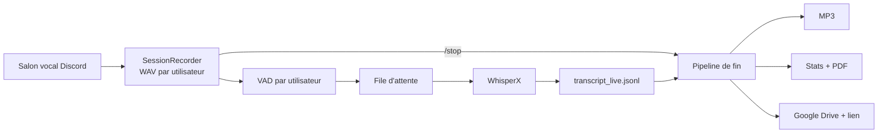

<div align="center">

# 🎙️ Discord Voice Recorder

**Un bot Discord qui enregistre un salon vocal, transcrit en quasi temps réel avec WhisperX,
puis livre MP3, transcript, rapport PDF et lien de partage Google Drive.**


</div>

---

## ✨ Fonctionnalités

- **Un fichier audio par participant**, écrit au fil de l'eau (WAV 16 kHz mono, lisible même pendant l'enregistrement) ; tous les fichiers partagent la même timeline.
- **Transcription quasi temps réel** : détection de voix (VAD) par utilisateur, découpage en énoncés, envoi à WhisperX, timestamps début/fin cohérents avec la session.
- **Anti-hallucinations** : garde-fou de niveau sonore + filtre de phrases fantômes (« Sous-titrage… »). Les segments rejetés sont conservés dans un fichier à part.
- **Surveillance de la file d'attente** ASR (barre dans la console et dans `/status`) pour voir si WhisperX prend du retard.
- **Fin de session automatisée** : MP3, statistiques (et palmarès amusant), rapport PDF, dépôt sur Google Drive, lien de partage. Chaque étape est **activable ou non** et son statut s'affiche dans le chat.
- **Tout est configurable** dans un seul `config.ini`, modifiable aussi depuis Discord avec `/config`.
- **Arbitrage de règles** : `/regle` envoie les dernières phrases à Google Gemini, qui explique ou précise le point de règle évoqué (jeu au choix, Pathfinder première édition par défaut).
- **Aucun message de transcription publié automatiquement** : `/transcript` affiche les derniers échanges, à la demande, pour tout le monde.
- Architecture modulaire (un fichier par composant) et suite de tests sans GPU ni connexion.

## 🧭 Fonctionnement



## 📦 Prérequis

| Élément | Installé par `install.bat` ? | Remarque |
|---|---|---|
| **conda** (Miniconda, Anaconda ou Miniforge) | ❌ **à installer avant** | [Miniconda](https://www.anaconda.com/docs/getting-started/miniconda/install) ou [Miniforge](https://github.com/conda-forge/miniforge) |
| Python 3.12 | ✅ dans l'environnement conda | WhisperX n'accepte pas Python 3.14 : l'environnement est indépendant de votre Python système |
| ffmpeg | ✅ dans l'environnement conda | nécessaire pour les MP3 |
| Git | ✅ dans l'environnement conda | nécessaire pour le fork de `discord-ext-voice-recv` |
| PyTorch (CPU ou GPU) | ✅ automatique | variante choisie selon `nvidia-smi` |
| Dépendances Python | ✅ automatique | `requirements.txt` |
| Pilote NVIDIA à jour | ❌ manuel | pour utiliser le GPU |
| CUDA Toolkit 12.8 | ❌ manuel, parfois utile | recommandé par WhisperX pour le GPU ; si cuDNN/ctranslate2 se plaint |
| Application Discord + token | ❌ manuel | voir ci-dessous |
| Clé d'API Gemini | ❌ manuel, optionnel | seulement pour `/regle` |
| Identifiants Google (`credentials.json`) | ❌ manuel, optionnel | seulement pour l'envoi sur Drive |

## 🚀 Installation rapide (Windows)

```bat
git clone https://github.com/<vous>/discord-voice-recorder.git
cd discord-voice-recorder
install.bat
```

`install.bat` accepte deux arguments facultatifs : `install.bat [auto|cpu|cu126|cu128] [nom_env]`. Le premier force la variante de PyTorch (défaut `auto`), le second change le nom de l'environnement conda (défaut `voicerecorder`).

Il : 1) localise conda, 2) crée l'environnement (Python 3.12 + ffmpeg + git, canal conda-forge), 3) installe PyTorch, 4) installe `requirements.txt`, 5) lance un diagnostic (`tools/check_env.py`).

> Lancez-le depuis un terminal normal ou « Anaconda Prompt » : conda est retrouvé automatiquement, même s'il n'est pas dans le PATH, dans ses dossiers d'installation habituels. Relancer `install.bat` est sans risque : l'environnement existant est réutilisé.

### Et PyTorch ?

Oui, c'est automatisé. Sur Windows, `pip install torch` depuis PyPI donne une version **CPU uniquement**. `tools/install_torch.py` lit la version CUDA supportée par votre pilote (`nvidia-smi`) et installe le bon build depuis l'index PyTorch :

| CUDA du pilote | Build installé |
|---|---|
| ≥ 12.8 (ou 13.x) | `cu128` |
| 12.6 – 12.7 | `cu126` |
| plus ancien / pas de GPU | `cpu` |

Si la détection échoue (ou conclut à `cpu`), l'installeur affiche un **menu** pour choisir le build à la main (CPU / CUDA 12.6 / CUDA 12.8 ; Entrée = valeur proposée). Pour ne jamais poser de question, par exemple en automatisation : `python tools/install_torch.py --no-prompt`.

Version épinglée : `torch==2.8.*` (exigée par WhisperX). Pour voir la commande sans l'exécuter : `python tools/install_torch.py --dry-run`.

## 🔧 Étapes manuelles

### 1. Créer le bot Discord

1. [Discord Developer Portal](https://discord.com/developers/applications) → *New Application* → onglet **Bot** → *Reset Token* et copiez le token.
2. Aucun intent privilégié n'est nécessaire.
3. **OAuth2 → URL Generator** : scopes `bot` et `applications.commands` ; permissions *View Channels*, *Send Messages*, *Embed Links*, *Connect*. Ouvrez l'URL générée pour inviter le bot.

### 2. Fournir le token

```bat
setx DISCORD_TOKEN "votre_token"
```

(puis nouveau terminal) — ou renseignez `token` dans la section `[discord]` de `config.ini`. Ne commitez jamais ce fichier (il est dans `.gitignore`).

### 3. Google Drive (optionnel)

1. [Google Cloud Console](https://console.cloud.google.com/) : créez un projet, activez **Google Drive API**.
2. *Écran de consentement OAuth* : ajoutez votre compte comme **utilisateur test**.
3. *Identifiants* → *ID client OAuth* de type **Application de bureau** → téléchargez le JSON et enregistrez-le sous `credentials.json` à la racine.
4. Au premier lancement, une fenêtre de navigateur demande l'autorisation ; `token.json` est créé.

En mode « Test », le jeton expire au bout de 7 jours : supprimez `token.json` et relancez pour ré-autoriser.

Sans `credentials.json`, le bot fonctionne normalement : l'étape Drive est simplement signalée comme indisponible.

### 4. Gemini pour `/regle` (optionnel)

1. Créez une clé sur [Google AI Studio](https://aistudio.google.com/apikey).
2. Définissez-la : `setx GEMINI_API_KEY "votre_cle"` (puis nouveau terminal), ou `cle_api` dans la section `[regles]` de `config.ini`.
3. Sans clé, le bot fonctionne normalement : `/regle` répond simplement qu'elle n'est pas configurée.

Le modèle (`modele`), le niveau de réflexion (`reflexion`, `low` par défaut pour des réponses rapides), la consigne envoyée à Gemini (`instruction`), le jeu par défaut, le nombre de phrases analysées et l'usage de la recherche Google (`recherche_web`) se règlent dans `[regles]`. Les réponses viennent d'un modèle d'IA et d'une transcription automatique : à vérifier dans le livre de règles.

### Un salon dédié aux messages système du bot (optionnel)

Pour ne pas polluer le salon principal : créez un salon texte (ex. `#bot-enregistrements`), activez le mode développeur de Discord (Paramètres → Avancés), faites clic droit sur le salon → *Copier l'identifiant du salon*, puis renseignez-le dans `config.ini` :

```ini
[discord]
canal_messages = 123456789012345678
```

Le bot doit avoir les droits *Voir le salon*, *Envoyer des messages* et *Intégrer des liens* dans ce salon. Il ne reçoit que les messages système et informatifs : suivi du traitement de fin de session, alertes, **une ligne de trace à chaque commande lancée** (`▶️ Nom : /commande paramètres`), compte rendu de `/campagne resumer` et `integrer`, fichiers de `/campagne pack sortie:fichier`. Les réponses aux demandes (`/regle`, `/transcript`, `/stats`, `/campagne afficher`…) et le message de consentement de `/record` restent dans le salon où la commande est tapée ; `/config` et `/campagne rollback` répondent en privé. Sans salon renseigné, tout reste dans le salon de la commande, sans trace. Si le salon est introuvable ou inaccessible, le bot répond là où la commande a été lancée, avec un avertissement dans la console.

### 5. Lancer

```bat
run.bat
```

Le modèle Whisper se charge dès le démarrage (état visible dans la console et dans le statut du bot). Lancez ensuite `/record` depuis un salon texte, en étant connecté à un salon vocal.

## 🕹️ Commandes

| Commande | Rôle |
|---|---|
| `/record` | Rejoint votre salon vocal et démarre l'enregistrement (avec message de consentement) |
| `/stop` | Arrête et lance le traitement de fin de session |
| `/transcript [nombre]` | Affiche les derniers messages transcrits, visibles de tous |
| `/regle [jeu] [phrases] [question] [dicter] [nom_voix]` | Envoie les dernières phrases du transcript à Gemini pour expliquer/préciser la règle évoquée. `jeu` : celui de la campagne, sinon *Pathfinder première édition* ; `phrases` : défaut 15 ; `question` : texte libre envoyé à la place du transcript (aucun enregistrement nécessaire) ; `dicter` : le bot lit la réponse à voix haute (`nom_voix` : voix de la dictée, sinon celle de la campagne) |
| `/campagne action [nom] [jeu] [mj] [fichier]` | Gère les campagnes : `liste`, `info`, `nouvelle` (membres du canal vocal = joueurs ; `mj` optionnel, sinon à définir), `mj` (désigne le MJ), `joueur` (ajoute ou met à jour un joueur : `membre`, `personnage` rapproché des personnages de `contexte.md`), `choisir`, `contexte` (Gemini structure un texte joint en `contexte.md`), `journal` (importe le journal existant comme résumé global initial), `rollback` (annule la dernière version du résumé global et la séance associée), `afficher` (compte rendu, « précédemment » ou résumé global ; `session:` propose la liste des séances, `rubrique:` n'affiche qu'une rubrique du résumé : fils ouverts, lieux, alliés…), `dicter` (le bot lit à voix haute le « précédemment » dans le canal vocal ; avec `nom_voix:` il le génère à la volée avec cette voix, sans toucher à l'audio préparé ni rien conserver), `pack` (prépare les prompts à coller dans un chat et les copie dans le presse-papiers ; `sortie:fichier`, `partie:`), `integrer` (réinjecte la réponse relue, lue dans le presse-papiers ou dans `fichier:`), `resumer` (**tout automatique** : le bot envoie la séance à Claude, avec ton abonnement, et intègre le résultat ; `rollback` pour annuler), `audio` / `audio force` (prépare l'audio du « précédemment », `nom_voix:` pour une autre voix), `voix` (liste les voix, ou en choisit une pour la campagne). Tout sauf `liste`, `info`, `afficher`, `dicter` et `voix` sans valeur demande « Gérer le serveur ». |
| `/dire texte [nom_voix]` | Le bot dit un texte à voix haute dans votre canal vocal (voix activée, permission *Gérer le serveur* ; pendant un enregistrement seulement si `liberer_whisper = non`) |
| `/stats` | Statistiques de la session en cours |
| `/retranscrire [session]` | Refait le transcript d'une session depuis ses fichiers audio complets, avec les réglages actuels (ancien transcript conservé dans `avant_retranscription_<date>/` ; *Gérer le serveur*) |
| `/status` | État de Whisper, de Drive et de la file d'attente |
| `/config` | Affiche/modifie les étapes de fin de session (permission *Gérer le serveur*) |

> Les commandes n'apparaissent parfois qu'après un rafraîchissement du client Discord (**Ctrl+R**). Pour une synchronisation instantanée, renseignez l'identifiant de votre serveur dans `[discord]` (`guild_id`).

## ⚙️ Configuration

Au premier lancement, `config.ini` est créé avec les valeurs par défaut et tous les commentaires ([`config.example.ini`](config.example.ini) en est une copie). Les clés manquantes sont ajoutées automatiquement ; une valeur invalide retombe sur le défaut avec un avertissement.

| Section | Contenu |
|---|---|
| `[discord]` | token, serveur de synchronisation, salon dédié aux messages du bot (`canal_messages`), message de consentement |
| `[modeles]` | dossier des modèles téléchargés (Whisper, alignement, OmniVoice, Chatterbox) : `modeles/` dans le dossier du programme par défaut, vide = cache habituel `~/.cache` |
| `[sessions]` | dossier de sortie |
| `[audio]` | tolérance de gigue, rythme d'écriture |
| `[vad]` | agressivité, pré-roll, silence de fin, durée max, **`niveau_min_dbfs`** |
| `[whisper]` | modèle, device, type de calcul, langue, filtre d'hallucinations, mots isolés ignorés (« merci », « au revoir », « bye », « amen » : parasites de Whisper sur les bruits) |
| `[live]` | rafraîchissement de la console, seuil d'alerte de file |
| `[stats]` | palmarès, mots exclus |
| `[rapport]` | options du PDF |
| `[fin_de_session]` | étapes activées : `mp3`, `rapport`, `drive`, `drive_audio`, `partage` |
| `[mp3]` | débit, chemin de ffmpeg |
| `[drive]` | identifiants, jeton, dossier racine |
| `[regles]` | accès Gemini (clé, modèle, réflexion) et commande `/regle` : jeu par défaut, nombre de phrases, consigne |
| `[voix]` | voix du bot (OmniVoice ou Chatterbox) : activation, moteur, lecture au `/record`, voix de référence, langue, vitesse, Python de l'environnement dédié |
| `[campagnes]` | commande `/campagne` et mémoire de campagne : dossier, tailles maximales, packs (`presse_papiers`, `pack_minutes`), génération par API (`resume_auto`, tranches, délai), moteur de `resumer` (`moteur_resume`), allègement des packs (`pack_fusion_s`) |
| `[claude]` | programme `claude` de ton abonnement pour `/campagne resumer` : commande, modèle, effort, délai |

Les étapes de `[fin_de_session]` sont relues à chaque `/stop`, sans redémarrer.

## 📁 Résultat d'une session

```
sessions/2026-10-30_120000/
├── meta.json                       # participants, durée
├── audio/                          # un WAV par utilisateur
├── audio_mp3/                      # MP3 (si activé)
├── transcript_live.jsonl           # brut, temps réel
├── transcript_live.txt             # transcript final trié, horodaté
├── transcript_live_rejected.jsonl  # segments écartés (hallucinations, trop faibles)
├── stats.json / stats.txt
├── avant_retranscription_<date>/   # ancien transcript, après un /retranscrire
└── rapport.pdf
```

### Où sont les modèles ?

Les modèles (Whisper, alignement, voix) sont téléchargés dans `modeles/` à côté du programme (`modeles/huggingface` et `modeles/torch`), et non dans `~/.cache`. Changez ou videz `dossier` dans `[modeles]` pour revenir au cache habituel. Les modèles déjà présents dans `~/.cache/huggingface` ne sont pas déplacés : ils sont retéléchargés (plusieurs Go) ; pour les réutiliser, copiez `~/.cache/huggingface/hub` dans `modeles/huggingface/`. Le changement vaut pour le bot **et** pour les environnements des voix (le bot leur transmet le dossier).

## 🩺 Dépannage

| Symptôme | Piste |
|---|---|
| `/record` sans effet | Ctrl+R dans Discord ; vérifier les permissions du bot |
| Pas de réception audio (DAVE) | `discord-ext-voice-recv` sur PyPI ne gère pas DAVE : `requirements.txt` utilise un fork épinglé |
| Textes fantômes sur des silences | augmenter `niveau_min_dbfs` (ex. `-40`) ; à l'inverse, le baisser (ex. `-55`) rend plus permissif |
| Transcription qui prend du retard | modèle plus petit (`small` → `base`), `calcul = int8`, ou GPU |
| GPU non utilisé | `python tools/check_env.py` ; relancer `install.bat cu128` ; mettre à jour le pilote |
| Erreur cuDNN / ctranslate2 | installer le CUDA Toolkit 12.8 |
| Drive : *403 access_denied* | ajouter votre compte comme utilisateur test, bon compte, API activée |
| MP3 en échec | ffmpeg introuvable : l'installer ou renseigner `[mp3] ffmpeg` |

`python tools/check_env.py` produit un diagnostic complet de l'environnement.

## ⚖️ Vie privée et consentement

Le bot enregistre la voix de personnes identifiables et en conserve la transcription. Informez les participants, obtenez leur accord et respectez la réglementation applicable (RGPD en Europe, règles de Discord). `/record` publie un message d'information dans le salon ; `/regle` transmet à Google (Gemini) les dernières phrases transcrites, nominativement ; le partage Drive par lien rend les fichiers accessibles à quiconque possède le lien — désactivez `partage` si besoin.

## 🛠️ Développement

```bash
conda create -n voicerecorder -c conda-forge python=3.12 ffmpeg git -y
conda activate voicerecorder
pip install -r requirements-dev.txt
python -m pytest
```

Les tests utilisent des doublures de Discord, torch et WhisperX : aucun GPU, token ni réseau requis. L'intégration continue (`.github/workflows/tests.yml`) les exécute à chaque push.

```
install.bat / run.bat / _conda.bat   # installation et lancement (conda)
bot_v4.py            # point d'entrée (le numéro suit la version du programme)
voicebot/
├── config.py        # config.ini : lecture, validation, édition
├── audio.py         # réception, WAV par utilisateur
├── vad.py           # détection de voix
├── whisper_engine.py# chargement et appel WhisperX
├── live.py          # transcription temps réel, anti-hallucinations
├── transcript.py    # transcript final
├── stats.py         # statistiques et palmarès
├── retranscrire.py  # refait le transcript d'une session depuis ses WAV (/retranscrire)
├── report.py        # PDF
├── mp3.py           # conversion ffmpeg
├── drive.py         # Google Drive
├── rules.py         # /regle : questions de règles via Gemini
├── pipeline.py      # étapes de fin de session + statut dans le chat
├── client.py        # client Discord, statut
└── commands.py      # commandes slash
tools/               # install_torch, check_env, make_config_example
```

Après toute modification des paramètres : `python tools/make_config_example.py` et `python tools/make_wiki.py` (un test vérifie que `config.example.ini` et `wiki/Configuration.md` sont à jour).

### Wiki

Le dossier [`wiki/`](wiki) contient la documentation détaillée : `Home.md` (vue d'ensemble, installation, déroulement), `Commandes.md` (toutes les commandes) et `Configuration.md` (toutes les clés de `config.ini` avec leurs défauts, générée). Pour la publier sur GitHub : activez le Wiki du dépôt, créez une première page, puis

```bash
git clone https://github.com/timpatim/TimBot-voicerecorder.wiki.git
cp wiki/*.md TimBot-voicerecorder.wiki/
cd TimBot-voicerecorder.wiki && git add . && git commit -m "Mise à jour du wiki" && git push
```

## 📄 Licence

Aucune licence n'est encore définie : ajoutez un fichier `LICENSE` de votre choix avant de publier.

## Campagnes (`/campagne`)

Chaque campagne a son dossier dans `campagnes/` : `campagne.json`, `joueurs.json` (MJ et joueurs, repérés par **identifiant Discord** puisque les pseudos changent), `contexte.md`, `seances/`, `resume_global/`. La campagne active est celle choisie en dernier ; `/record` l'affiche sous le message de consentement et en garde la trace dans `campagne.json` du dossier de session.

1. Rejoignez le canal vocal puis `/campagne nouvelle nom:Hell's Rebels mj:@quelqu'un` : les membres du canal sont pré-remplis (le MJ n'est jamais déduit ; sans `mj`, utilisez `/campagne mj` plus tard).
2. `/campagne contexte fichier:description.txt` : Gemini restructure votre texte (personnages, secrets, glossaire) en `contexte.md`, et associe les personnages aux joueurs. **Aucun secret n'est déduit** : sans indication explicite, un fait est marqué `[à confirmer]`. Si `contexte.md` est déjà rempli, la proposition va dans `contexte_propose.md`.
3. Relisez et corrigez à la main : tout reste en fichiers texte modifiables.

Confidentialité : le texte envoyé à `/campagne contexte` part chez Google (Gemini).

### Reprendre une campagne existante (ex. Hell's Rebels)

1. `/campagne nouvelle` (depuis le canal vocal, avec `mj:`), 2. `/campagne contexte fichier:personnages.txt`, 3. `/campagne journal fichier:journal.txt` : le journal devient la version 1 du résumé global (`resume_global/v001_…`).

### Comparer des réglages de transcription (outil de test)

`tools/comparer_transcription.py` rejoue une session déjà enregistrée (les WAV par joueur) avec d'autres réglages, sans toucher à la session, et compare les résultats : lignes très courtes, débit impossible, « au revoir / bye / amen » parasites, lignes tronquées, et taux d'erreurs si vous fournissez un extrait corrigé à la main. Exemples :

```
python tools/comparer_transcription.py sessions/2026-11-03_214508 --sans-whisper
python tools/comparer_transcription.py sessions/2026-11-03_214508 --de 00:40:00 --a 01:00:00
python tools/comparer_transcription.py sessions/2026-11-03_214508 --de 00:40:00 --a 00:45:00 --reference extrait_corrige.txt
python tools/comparer_transcription.py sessions/2026-11-03_214508 --variante "test=silence_fin_ms:900,fusion_s:1"
```

`--sans-whisper` ne fait que le découpage (rapide, sans GPU) et montre combien d'énoncés chaque réglage produit. Les variantes prédéfinies (`actuel`, `reglages`, `filtre`, `fusion`, `contexte`) sont décrites en tête du script. Résultats dans `<session>/comparaison/` : `rapport.md`, un transcript par variante, `differences_*.md` (fenêtres de 30 s qui diffèrent) et `rejetes.txt`. Les résultats de Whisper sont mis en cache : relancer ne retranscrit que ce qui a changé. À lancer bot arrêté (il partage le GPU).

### Mémoire de campagne automatique : `/campagne resumer` avec Claude

`/campagne resumer` fait tout en une commande : il prépare le pack, le soumet au programme officiel **`claude`** (Claude Code) installé sur la machine du bot, **avec ton abonnement** (aucune clé d'API, aucune facturation à l'unité), puis intègre la réponse : compte rendu, « précédemment », nouvelle version du résumé global. Tu vois le récapitulatif (modèle, durée, tokens) et un `/campagne rollback` annule le tout. Rien ne se déclenche seul : ni à la fin de session, ni ailleurs.

**Mise en place (une fois)** : installe Claude Code sur la machine du bot, ouvre un terminal, lance `claude` puis `/login`. Dans `config.ini`, la section `[claude]` règle `modele` (`sonnet` par défaut), `effort` (`medium` par défaut, ~2 min par séance ; `low` est plus rapide mais moins fiable), `delai_s` et `commande` si `claude` n'est pas dans le PATH. Les essais ont montré que Haiku invente des détails et que `medium` est plus fiable que `low`, même si le modèle n'a plus à réécrire tout le résumé.

**Ce que le modèle écrit, et ce que fait le programme** : le modèle ne renvoie que ce qui change (compte rendu, changements, texte de la séance pour la « Chronologie », rubriques modifiées, « précédemment »). C'est le **programme** qui ajoute le paragraphe à la fin de la chronologie existante et ne remplace que les rubriques citées : les anciennes séances ne sont jamais recopiées ni abrégées. Compatible avec les campagnes déjà alimentées : l'ancien résumé reste la base (titres Markdown, lignes en gras, ou texte libre importé avec `journal`) ; si une rubrique « Chronologie » manque, elle est créée à la fin et le bot le signale. Il avertit aussi quand une rubrique remplacée est nettement plus courte que l'ancienne, ou quand le « précédemment » dépasse la longueur visée. L'ancien format de réponse (`=== RESUME GLOBAL ===`) reste accepté par `integrer`.

**Précautions** : `claude` est lancé sans outil, sans serveur MCP, sans plugins ni réglages perso, dans un dossier vide, et `ANTHROPIC_API_KEY` est retirée de son environnement (sinon l'API serait facturée). La transcription est traitée comme une donnée, jamais comme une consigne. Le pack part chez Anthropic : contexte, résumé global et transcript. Relis le résultat au début (secrets `[secret:…]` / `[mj]`), tu as `/campagne afficher` et `rollback`. Un usage individuel, occasionnel, est dans l'esprit de l'abonnement ; ne lance pas la commande en rafale. Si la limite d'usage de ton abonnement est atteinte, le bot l'indique. Pour l'ancienne méthode, `moteur_resume = gemini`.

Les `packs` ci-dessous restent disponibles si tu préfères relire à la main dans un chat.

### Mémoire de campagne sans API : les packs

Sans payer d'API, le bot prépare le travail et vous utilisez le chat de votre choix (Gemini, Claude…).

1. **`/campagne pack`** (plus de préparation automatique en fin de session) : le bot écrit dans `seances/<session>/pack/` un ou plusieurs fichiers `pack_*.md` et **copie le pack dans le presse-papiers** de la machine du bot (`partie:2`… pour les packs découpés ; `sortie:fichier` publie les fichiers dans le salon à la place). Chaque fichier contient les consignes, le contexte, le résumé global actuel et le transcript nettoyé **avec l'horodatage de chaque réplique**. Par défaut, un seul pack par séance. Si votre chat ne lit pas les longs fichiers jusqu'au bout (c'était le cas de Gemini), découpez en parties : `pack_minutes = 60` dans `[campagnes]`, ou `minutes:60` dans `/campagne pack` (`0` = pas de découpe).
2. **Dans le chat** : si le pack est découpé, collez les parties dans l'ordre, dans la **même conversation** (Ctrl+V). Chaque réponse commence par `=== FIN LUE === hh:mm:ss | « dernière réplique »` : l'horodatage et le texte de la dernière réplique lue, à comparer à la « fin attendue » et à la dernière réplique indiquées par le bot. Un écart signale une lecture tronquée. La dernière partie produit aussi le compte rendu, la mise à jour du résumé global et le « précédemment ».
3. **Relisez et corrigez** la réponse (vérifiez les secrets), copiez-la avec le bouton du chat, puis `/campagne integrer` : le bot la lit dans le presse-papiers (ou dans un fichier joint : `fichier:reponse.txt`). Le bot vérifie la fin de lecture (avertissement si l'horodatage s'écarte, si la réplique citée n'existe pas parmi les dernières du transcript, ou si les notes s'arrêtent loin de la fin), range le compte rendu dans la séance, crée la version suivante du résumé global et mémorise le « précédemment » pour le prochain `/record`. `rollback` annule l'intégration.

Les réponses doivent contenir les lignes `=== COMPTE RENDU ===`, `=== CHANGEMENTS ===`, `=== CHRONOLOGIE ===`, `=== SECTIONS ===` et `=== PRECEDEMMENT ===` (l'ancien `=== RESUME GLOBAL ===` complet reste accepté). Le pack est allégé : les répliques consécutives d'un même locuteur sont fusionnées (`pack_fusion_s`, 10 s). Si le modèle les oublie, redemandez-les. Le presse-papiers est celui de **la machine du bot**, que le bot ne peut pas comparer à celle de votre client Discord : s'ils sont sur deux ordinateurs, mettez `presse_papiers = non` (`[campagnes]`) et utilisez les fichiers (Windows : PowerShell ; macOS : pbcopy/pbpaste ; Linux : xclip ou wl-clipboard). Les packs contiennent votre contexte et le transcript : ils sont envoyés à l'outil que vous choisissez de les coller.

### Mémoire automatique par API (optionnelle)

Désactivée par défaut (`resume_auto = non`), car elle consomme beaucoup de requêtes Gemini (une séance de 3 h = une dizaine d'appels, ce que le palier gratuit de l'API ne supporte pas). Si vous l'activez, qu'une campagne est active et qu'une clé Gemini est configurée, l'étape « Mémoire de campagne » enchaîne : nettoyage du transcript (rôles par identifiant Discord, interjections retirées), extraction des faits par tranche de 30 min, **compte rendu** (publié dans le salon et déposé sur le Drive), **nouvelle version du résumé global** et **« Dans l'épisode précédent… »**, affiché au prochain `/record` sous le message de consentement. Tout est écrit dans `campagnes/<nom>/seances/<session>/` (`compte_rendu.md`, `precedemment.md`, `extractions.md`, `transcript_nettoye.txt`). Le résumé global n'est modifié qu'une fois toutes les étapes réussies ; en cas d'échec de Gemini, `/campagne resumer` relance sans rien perdre. Les secrets marqués `[secret:…]` / `[mj]` dans `contexte.md` ne doivent pas apparaître dans ces textes lus par tous : relisez-les au début.

`/campagne resumer fichier:transcript.txt session:2026-10-24` intègre un ancien transcript (formats du bot, entre crochets ou SRT) ; sans fichier, il reprend la dernière session enregistrée (ou celle de `session`). Attention : le journal importé et les séances peuvent se recouper ; Gemini fusionne sans doublon.

Confidentialité : le transcript nettoyé et le contexte sont envoyés à Google (Gemini).

### Retour en arrière

Chaque mise à jour du résumé global (import du journal, fin de session) crée une nouvelle version `vNNN_*.md` (jamais écrasée). `/campagne rollback` annule la dernière : elle est archivée dans `resume_global/annulees/` et la précédente redevient le résumé actif. Répétez pour remonter plus loin.

## Transcript nettoyé

À la fin de session, en plus du transcript brut (`transcript_live.txt`, conservé en local), le bot écrit `transcript_nettoye.txt`, sans appel à Gemini. Le nettoyage est volontairement prudent : **une ligne par réplique, avec son locuteur et son horodatage d'origine**, dans l'ordre chronologique. Seuls les sons sans sens (« euh », « hum », « hmm »…) sont retirés (`nettoyage_mots_ignores`) ; « oui », « non », « ok » sont conservés car ce sont des réponses. Aucune fusion de répliques par défaut (`nettoyage_fusion_s = 0`) ; si vous mettez une valeur, la fusion ne se fait jamais par-dessus la réplique d'un autre locuteur. Si une campagne est active, les locuteurs y apparaissent comme « MJ » / « Personnage (joueur) ». **C'est ce fichier qui est déposé sur le Drive** ; mettez `drive_transcript_brut = oui` dans `[fin_de_session]` pour y déposer aussi le brut.

Avec un transcript joint (`pack` ou `resumer` avec `fichier`), le paramètre `session` est obligatoire (`2026-10-24` ou `2026-10-24_190000`) : il donne la date de la séance.

## Voix du bot (OmniVoice ou Chatterbox, optionnelle)

Le bot peut dicter à voix haute le « Dans l'épisode précédent… » (et seulement lui) au démarrage d'un enregistrement, et à la demande avec `/campagne dicter` (`session:` pour une autre séance). Deux moteurs au choix (`moteur` dans `[voix]`) : [OmniVoice](https://github.com/k2-fsa/OmniVoice) (par défaut ; multilingue, code Apache 2.0, **poids du modèle sous licence CC-BY-NC : usage non commercial**) et [Chatterbox](https://github.com/resemble-ai/chatterbox) (français inclus, licence MIT, ajoute un filigrane inaudible « perth » à l'audio). **Voix désactivée par défaut.**

**Principe : le bot ne lit qu'un fichier audio préparé à l'avance.** Deux modes, selon `liberer_whisper` dans `[voix]` :
- **`non` (défaut)** : Whisper reste chargé. La voix (`/campagne audio`, `/dire`) fonctionne aussi pendant un enregistrement, la transcription continue, mais il faut assez de mémoire GPU pour les deux modèles : la console affiche la mémoire utilisée avant et après chaque synthèse (`mémoire GPU … Go utilisés`) pour en juger. Avec OmniVoice, **le modèle est chargé une seule fois au démarrage du bot** (console : `[bot] voix : modèle prêt en mémoire`) et reste dans un processus permanent, relancé automatiquement s'il plante : plus d'attente de chargement à chaque audio, mais de la mémoire GPU occupée en permanence. Si la mémoire manque, passez à `oui`.
- **`oui`** : pour préparer un audio, le bot **libère Whisper de la mémoire, lance le moteur vocal, puis recharge Whisper** (quelques dizaines de secondes, l'état s'affiche dans le statut du bot ; le modèle vocal est alors chargé à chaque audio et pas au démarrage) ; la synthèse est alors refusée pendant un enregistrement, et `/record` pendant une synthèse.

Dans les deux modes, la voix du bot n'est jamais enregistrée ni envoyée à Whisper (son identifiant est ignoré par l'enregistreur).
- L'audio (`seances/<session>/precedemment.wav`) est préparé **automatiquement après `/campagne integrer`**, ou avec **`/campagne audio`** (permission « Gérer le serveur »). 
- Si l'audio n'existe pas pour la séance visée, ou si le texte du « précédemment » a été modifié depuis sa préparation, `/record` et `/campagne dicter` le signalent en nommant la séance et ne disent rien. Si seuls les **réglages de la voix** ont changé (vitesse, moteur, pause...), l'audio reste lu tel quel avec une note ; `/campagne audio force` le refait. La séance visée est toujours la dernière qui a un « précédemment » : si elle n'a pas encore d'audio, le message propose les séances qui en ont (paramètre `session`).

Installation :
1. Lancez l'installeur du moteur choisi : `install_omnivoice.bat` (crée l'environnement conda séparé `voicerecorder-omnivoice`, Python 3.11, avec PyTorch 2.8 CPU ou GPU puis `omnivoice`) ou `install_voix.bat` (environnement `voicerecorder-voix` avec `chatterbox-tts`, puis un PyTorch GPU de la même version). Chaque moteur a son environnement ; le bot l'appelle comme un programme externe, le sien n'est pas touché. Le premier lancement télécharge le modèle (plusieurs Go). Changer de moteur dans `config.ini` invalide les audios déjà préparés.
2. Dans `config.ini`, section `[voix]` : `activer = oui`. `au_demarrage = non` désactive seulement la lecture au `/record`.
3. **Voix** : par défaut, la voix du moteur. Pour en cloner une, déposez un échantillon (~10 s de parole claire) dans le dossier commun `voix/` (réglage `dossier`) sous le nom `voix.<nom>.wav` (ou `.mp3`, `.flac`). Avec OmniVoice, ajoutez `voix.<nom>.txt` contenant ce que dit l'échantillon : sans lui, OmniVoice le transcrit avec Whisper, au risque d'une erreur. `/campagne voix` liste les voix et change celle de la campagne (enregistrée dans `campagne.json`, permission *Gérer le serveur*) ; `/dire` et `/campagne audio` ont un paramètre `nom_voix` pour une voix ponctuelle. L'ancien `voix.wav` dans le dossier de la campagne et `voix_reference` fonctionnent encore, avec une priorité plus basse. N'utilisez que la voix d'une personne qui a donné son accord. Changer de voix invalide l'audio : refaites `/campagne audio`.

4. **Durée et rythme** : `vitesse` (1.0 par défaut, de 0.5 à 2.0 ; 1.15 est un peu plus rapide) accélère la lecture sans changer la hauteur de la voix (ffmpeg, après la synthèse) ; `pause_s` règle le silence entre deux morceaux ; `mots` (110 par défaut, soit environ 40 s) fixe la longueur demandée à l'IA dans les prompts du « précédemment ». Ce dernier ne change pas un texte déjà écrit : modifiez `precedemment.md` ou refaites le pack. Chaque changement invalide l'audio : refaites `/campagne audio`.
5. **Audio raté** (mots farfelus, bruits) : la synthèse varie d'un essai à l'autre. `/campagne audio force` en refait un nouveau même si l'audio est à jour ; l'ancien est gardé en `precedemment.precedent.wav` (et remis en place si la nouvelle synthèse échoue). Pour un ton plus vivant, c'est le texte qui compte (le prompt du « précédemment » demande un récap de série télé) : OmniVoice n'accepte pas d'instruction d'émotion, mais comprend des marques comme `[laughter]` ou `[sigh]` dans le texte. Avec Chatterbox, baissez `temperature` si les ratés sont fréquents ; avec OmniVoice, `etapes` (32 par défaut) règle la qualité (16 = plus rapide).

Pendant `/campagne audio`, le message affiche une **barre de progression** (libération de Whisper, chargement du modèle, morceau par morceau). Avec OmniVoice, un morceau nettement plus court que son texte (fin avalée) est détecté et régénéré jusqu'à 2 fois, avec une durée imposée d'après son nombre de mots ; l'audio se termine par un court silence, et le bot attend un instant avant de quitter le canal pour ne pas couper la fin.

En cas d'échec, le bot l'indique et l'enregistrement continue. La voix du bot n'est pas transcrite.
