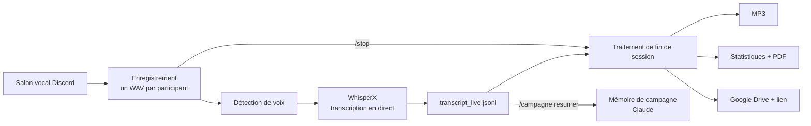

# Discord Voice Recorder

Un bot Discord qui **enregistre un salon vocal**, **transcrit en quasi temps réel** avec WhisperX, puis livre un MP3, un
transcript, un rapport PDF et un lien de partage Google Drive. Pour les parties de jeu de rôle, il tient aussi la
**mémoire de la campagne** (compte rendu, résumé global) et lit à voix haute un « Dans l'épisode précédent… » au début
de la séance suivante.

Pages du wiki :

- **[Commandes](Commandes)** : toutes les commandes slash, leurs paramètres et leurs permissions.
- **[Configuration](Configuration)** : toutes les clés de `config.ini` avec leur valeur par défaut.
- Cette page : vue d'ensemble, installation, déroulement d'une séance, dossiers produits, dépannage.

## Vue d'ensemble



- **Un fichier audio par participant**, écrit au fil de l'eau, toutes les pistes partageant la même timeline.
- **Anti-hallucinations** : seuil de niveau sonore et filtre de phrases fantômes (« Sous-titrage… »). Les segments rejetés
  sont conservés à part.
- **Tout est configurable** dans un seul `config.ini` ([Configuration](Configuration)).
- **Aucun message de transcription n'est publié automatiquement** ; `/transcript` les affiche à la demande.

## Installation (Windows)

Prérequis à installer avant : **conda** (Miniconda ou Miniforge) et un pilote NVIDIA à jour pour utiliser le GPU.

```bat
git clone https://github.com/timpatim/TimBot-voicerecorder.git
cd TimBot-voicerecorder
install.bat
```

`install.bat` crée l'environnement conda `voicerecorder` (Python 3.12, ffmpeg, git), installe la bonne version de PyTorch
(CPU ou CUDA, selon `nvidia-smi`) puis les dépendances, et lance un diagnostic.

Ensuite, à faire à la main :

1. **Créer le bot** sur le [Discord Developer Portal](https://discord.com/developers/applications). Aucun intent privilégié.
   Scopes `bot` et `applications.commands` ; permissions *Voir les salons*, *Envoyer des messages*, *Intégrer des liens*,
   *Se connecter*, et *Parler* si vous utilisez la voix du bot.
2. **Fournir le token** : `setx DISCORD_TOKEN "votre_token"` (puis nouveau terminal), ou `token` dans `[discord]`.
3. *(optionnel)* **Google Drive** : `credentials.json` à la racine (client OAuth de type « Application de bureau »). Au premier
   lancement, un navigateur demande l'autorisation et crée `token.json`.
4. *(optionnel)* **Claude** pour la mémoire de campagne (`/campagne resumer`, `contexte`, `condenser`, `/glossaire corriger`) :
   installez Claude Code sur la machine du bot, puis `claude` et `/login` dans un terminal. Le bot utilise votre abonnement,
   sans clé d'API. Réglages : [`[claude]`](Configuration#claude).
5. *(optionnel)* **Gemini** pour `/regle` uniquement : `setx GEMINI_API_KEY "votre_cle"`.
6. **Lancer** : `run.bat`. Le modèle Whisper se charge dès le démarrage.

Sans Drive, Claude ni Gemini, le bot fonctionne normalement : ces étapes sont simplement signalées comme indisponibles.

## Déroulement d'une séance

### 1. Avant la première séance : créer la campagne

1. Depuis le canal vocal : `/campagne nouvelle nom:... mj:@quelqu'un`. Les membres du canal deviennent joueurs ; le MJ n'est
   jamais déduit.
2. `/campagne contexte fichier:description.txt` : Claude structure votre texte (personnages, secrets, glossaire) en
   `contexte.md`. Relisez-le : aucun secret n'est déduit, et les faits douteux sont marqués `[à confirmer]`.
3. Pour une campagne déjà commencée : `/campagne journal fichier:journal.txt` importe votre journal comme premier résumé global,
   et `/campagne resumer fichier:transcript.txt session:2026-10-24` intègre un transcript existant (`session` = date de la séance).
4. Ajoutez des joueurs à la volée avec `/campagne joueur`.

### 2. Pendant la séance

`/record` démarre l'enregistrement. Si la voix est activée, le bot lit le « précédemment » de la dernière séance. `/stats`,
`/status`, `/transcript` et `/regle` donnent le suivi en direct.

### 3. Après la séance

`/stop` lance le traitement de fin de session : transcript, MP3, rapport PDF, envoi sur Drive.

### 4. La mémoire de campagne : `/campagne resumer`

`/campagne resumer` soumet la séance à Claude (le programme `claude` de votre abonnement) en trois appels :

1. **Nettoyage** : Claude liste les corrections du transcript (noms, termes de jeu mal reconnus) ; le bot les valide et les
   applique sur une copie, l'original reste intact.
2. **Analyse et questions** : Claude rédige un brouillon et pose aux joueurs ses questions sur les ambiguïtés du scénario
   (menus dans le salon, bouton « Valider les réponses », réservé à *Gérer le serveur*). Sans réponse, l'ambiguïté reste notée.
3. **Version finale** : le compte rendu, la séance ajoutée à la chronologie du résumé global, les rubriques modifiées et le
   « précédemment », dont l'audio est préparé aussitôt.

Le modèle ne renvoie que ce qui change : les anciennes séances ne sont jamais réécrites. `/campagne rollback` annule.

- **Glossaire** : les noms corrigés et les décisions prises en répondant aux questions sont gardés dans `glossaire.md` et
  resservent aux séances suivantes. `/glossaire corriger` rectifie une information fausse.
- **À retenir** : si un joueur demande à voix haute de retenir une information (« l'IA, retiens bien ce que vient d'expliquer
  le MJ »), Claude la repère et la fait figurer dans une rubrique « À retenir » du compte rendu et dans le résumé global.
- **Condenser** : quand la chronologie s'allonge (un donjon sur plusieurs séances), `/campagne condenser` regroupe des séances
  en un *Chapitre*, puis des chapitres en *Livre*. Chaque condensé a son compte rendu, son « précédemment » et son audio.
- **Quel « précédemment » est lu au `/record` ?** Celui de la dernière séance de la campagne, réelle ou condensée.

### 5. La voix du bot (optionnelle)

Le bot lit le « précédemment » (fichier audio **préparé à l'avance**) et, avec `/dicter`, n'importe quel texte. Réglage
`liberer_whisper` de `[voix]` : `non` (défaut) garde Whisper en mémoire, la voix marche pendant un enregistrement mais il faut
assez de mémoire GPU pour les deux (la console affiche la mémoire utilisée) ; le modèle vocal est préchargé au démarrage du bot ; `oui` libère Whisper pendant la synthèse et
refuse la voix pendant un enregistrement. La voix du bot n'est jamais transcrite.

- Moteur : **OmniVoice**. Ses poids sont sous licence CC-BY-NC (usage non commercial).
- Installation : `install_omnivoice.bat` crée un environnement conda séparé pour le moteur, puis `activer = oui` dans `[voix]`.
- Préparation : automatique après `/campagne resumer` et `/campagne condenser`, ou avec `/campagne audio`. Avec `liberer_whisper = oui`, Whisper est
  libéré de la mémoire pendant la synthèse puis rechargé.
- Pendant la préparation, un message affiche une barre de progression. Un morceau tronqué est détecté et régénéré.
- Texte libre : `/dicter texte:...` dit n'importe quel texte avec la même voix ; l'audio vous est envoyé en pièce jointe.
- Audio raté : `/campagne audio forcer:oui` en refait un autre ; l'ancien est gardé en `precedemment.precedent.wav`.
- Voix : celle du moteur par défaut, ou une voix clonée à partir d'un échantillon `voix/voix.<nom>.wav` (~10 s de parole claire) ;
  plusieurs voix possibles, choisies par campagne avec `/campagne voix` ou ponctuellement avec le paramètre `nom_voix` de `/dicter` et
  `/campagne audio`. Ajoutez `voix/voix.<nom>.txt` : la transcription de l'échantillon. **N'utilisez que la voix d'une personne qui a donné son accord.**
- Réglages : `vitesse`, `pause_s`, `etapes`, `mots` dans [`[voix]`](Configuration#voix).

## Où sont les modèles ?

Dans `modeles/` à côté du programme (`modeles/huggingface`, `modeles/torch`), pas dans `~/.cache`. Le réglage est `dossier`
de [`[modeles]`](Configuration#modeles) ; vide = cache habituel. Les modèles déjà téléchargés ailleurs sont retéléchargés :
copiez `~/.cache/huggingface/hub` dans `modeles/huggingface/` pour les réutiliser.

## Fichiers produits

### Une session (`sessions/`)

```
sessions/2026-10-30_120000/
├── meta.json                       # participants, durée
├── campagne.json                   # campagne active au démarrage
├── audio/                          # un WAV par utilisateur
├── audio_mp3/                      # MP3 (si activé)
├── transcript_live.jsonl           # brut, temps réel
├── transcript_live.txt             # transcript final trié, horodaté
├── transcript_live_rejected.jsonl  # segments écartés (hallucinations, trop faibles)
├── stats.json / stats.txt
├── avant_retranscription_<date>/   # ancien transcript, après un /retranscrire
└── rapport.pdf
```

### Une campagne (`campagnes/`)

```
campagnes/<campagne>/
├── campagne.json                   # titre, jeu
├── joueurs.json                    # MJ et joueurs, repérés par identifiant Discord
├── contexte.md                     # personnages, secrets, glossaire de départ (à relire)
├── glossaire.md                    # glossaire appris : noms corrigés, décisions de scénario
├── glossaire_versions/             # sauvegardes avant chaque /glossaire corriger
├── resume_global.md                # résumé actif
├── resume_global/vNNN_*.md         # toutes les versions (annulees/ pour les retours en arrière)
└── seances/
    ├── <séance>/
    │   ├── compte_rendu.md
    │   ├── precedemment.md
    │   ├── precedemment.wav        # audio préparé (+ .voix.json / .voix.txt, .precedent.wav)
    │   ├── meta.json               # version du résumé global créée par cette séance
    │   └── analyse/                # étapes de /campagne resumer : transcript corrigé, questions, réponses, pack
    └── <séance>_chapitre_<titre>/  # un condensé : compte_rendu.md, precedemment.md, audio, meta.json
```

Les séances annulées par `rollback` sont déplacées dans `seances/_annulees/` et ignorées.
Pour savoir quel « précédemment » est lu : le bot prend le **dernier dossier** (par ordre alphabétique, donc par date) qui
contient un `precedemment.md`. Un condensé porte le nom de la dernière séance qu'il couvre : il passe juste après elle.

## Vie privée et consentement

Le bot enregistre la voix de personnes identifiables et conserve leur transcription. Informez les participants, obtenez leur
accord et respectez la réglementation applicable (RGPD, règles de Discord). `/record` publie un message d'information dans
le salon.

Données qui quittent votre machine :
- `/regle` envoie les dernières phrases du transcript (ou votre question) à **Google (Gemini)**, avec le nom de leurs auteurs ;
- `/campagne resumer`, `contexte`, `condenser` et `/glossaire corriger` envoient le contexte, le résumé global et le transcript
  à **Anthropic (Claude)**, par le programme `claude` de votre abonnement ;
- le partage Drive par lien rend les fichiers accessibles à quiconque possède le lien (désactivable avec `partage = aucun`).

## Dépannage

| Symptôme | Piste |
|---|---|
| `/record` sans effet, commandes absentes | Ctrl+R dans Discord ; vérifier les permissions du bot |
| Pas de réception audio | `discord-ext-voice-recv` sur PyPI ne gère pas le chiffrement DAVE : `requirements.txt` utilise un fork épinglé |
| Le bot parle mais aucun son | Vérifier la sortie audio de **votre** appareil (casque ou haut-parleurs), puis la permission *Parler* et le volume du bot |
| Synthèse vocale : mémoire GPU insuffisante | `device = cpu` dans `[voix]` (plus lent) |
| Audio avec mots farfelus ou bruits | `/campagne audio forcer:oui` en refait un autre |
| `/campagne resumer` : « Claude indisponible » | Installer Claude Code sur la machine du bot, puis `claude` et `/login` ; ou indiquer son chemin dans `commande` de `[claude]` |
| Une information demandée « à retenir » manque dans le compte rendu | `/campagne rollback` puis `/campagne resumer` ; ou l'ajouter avec `/glossaire corriger` |
| La transcription prend du retard | Voir la file dans `/status` ; un modèle Whisper plus petit ou le GPU règlent le problème |

## Développement

```bash
conda activate voicerecorder
pip install -r requirements-dev.txt
python -m pytest
```

Les tests utilisent des doublures de Discord, torch et WhisperX : ni GPU, ni token, ni réseau.

Après toute modification des paramètres de `voicebot/config.py`, régénérez deux fichiers :

```bash
python tools/make_config_example.py   # config.example.ini
python tools/make_wiki.py             # wiki/Configuration.md
```

Un test vérifie que les deux sont à jour, et que `wiki/Commandes.md` cite toutes les commandes du bot.
La page `Commandes` est écrite à la main : mettez-la à jour quand une commande ou une action change.

Pour publier le wiki sur GitHub, copiez le contenu du dossier `wiki/` dans le dépôt `TimBot-voicerecorder.wiki.git`
(voir le README).
