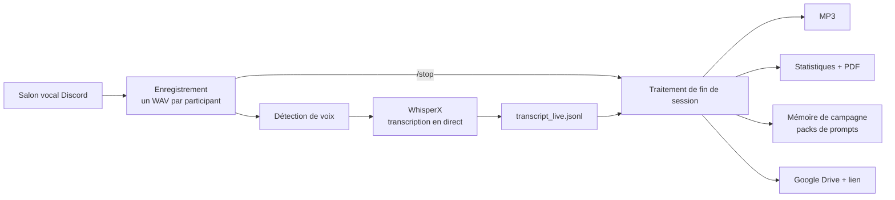

# Discord Voice Recorder

Un bot Discord qui **enregistre un salon vocal**, **transcrit en quasi temps réel** avec WhisperX, puis livre un MP3, un
transcript, un rapport PDF et un lien de partage Google Drive. Pour les parties de jeu de rôle, il tient aussi la
**mémoire de la campagne** (compte rendu, résumé global) et lit à voix haute un « Dans l'épisode précédent… » au début
de la séance suivante.

Pages du wiki :

- **[Commandes](Commandes)** : toutes les commandes slash, leurs paramètres et leurs permissions.
- **[Configuration](Configuration)** : toutes les clés de `config.ini` avec leur valeur par défaut.
- Cette page : vue d'ensemble, installation, déroulement d'une séance, dossiers produits, dépannage.

## Vue d'ensemble



- **Un fichier audio par participant**, écrit au fil de l'eau, toutes les pistes partageant la même timeline.
- **Anti-hallucinations** : seuil de niveau sonore et filtre de phrases fantômes (« Sous-titrage… »). Les segments rejetés
  sont conservés à part.
- **Tout est configurable** dans un seul `config.ini` ([Configuration](Configuration)).
- **Aucun message de transcription n'est publié automatiquement** ; `/transcript` les affiche à la demande.

## Installation (Windows)

Prérequis à installer avant : **conda** (Miniconda ou Miniforge) et un pilote NVIDIA à jour pour utiliser le GPU.

```bat
git clone https://github.com/timpatim/TimBot-voicerecorder.git
cd TimBot-voicerecorder
install.bat
```

`install.bat` crée l'environnement conda `voicerecorder` (Python 3.12, ffmpeg, git), installe la bonne version de PyTorch
(CPU ou CUDA, selon `nvidia-smi`) puis les dépendances, et lance un diagnostic.

Ensuite, à faire à la main :

1. **Créer le bot** sur le [Discord Developer Portal](https://discord.com/developers/applications). Aucun intent privilégié.
   Scopes `bot` et `applications.commands` ; permissions *Voir les salons*, *Envoyer des messages*, *Intégrer des liens*,
   *Se connecter*, et *Parler* si vous utilisez la voix du bot.
2. **Fournir le token** : `setx DISCORD_TOKEN "votre_token"` (puis nouveau terminal), ou `token` dans `[discord]`.
3. *(optionnel)* **Google Drive** : `credentials.json` à la racine (client OAuth de type « Application de bureau »). Au premier
   lancement, un navigateur demande l'autorisation et crée `token.json`.
4. *(optionnel)* **Gemini** pour `/regle` et `/campagne contexte` : `setx GEMINI_API_KEY "votre_cle"`.
5. **Lancer** : `run.bat`. Le modèle Whisper se charge dès le démarrage.

Sans Drive ni Gemini, le bot fonctionne normalement : ces étapes sont simplement signalées comme indisponibles.

## Déroulement d'une séance

### 1. Avant la première séance : créer la campagne

1. Depuis le canal vocal : `/campagne nouvelle nom:... mj:@quelqu'un`. Les membres du canal deviennent joueurs ; le MJ n'est
   jamais déduit.
2. `/campagne contexte fichier:description.txt` : Gemini structure votre texte (personnages, secrets, glossaire) en
   `contexte.md`. Relisez-le : aucun secret n'est déduit, et les faits douteux sont marqués `[à confirmer]`.
3. Pour une campagne déjà commencée : `/campagne journal fichier:journal.txt` importe votre journal comme premier résumé global.
4. Ajoutez des joueurs à la volée avec `/campagne joueur`.

### 2. Pendant la séance

`/record` démarre l'enregistrement. Si la voix est activée, le bot lit le « précédemment » de la dernière séance. `/stats`,
`/status`, `/transcript` et `/regle` donnent le suivi en direct.

### 3. Après la séance

`/stop` lance le traitement de fin de session : transcript, MP3, rapport PDF, préparation des packs, envoi sur Drive.

### 4. La mémoire de campagne : les packs

Pour ne pas payer d'API, le bot prépare le travail et vous utilisez le chat de votre choix (Claude, Gemini…).

1. Le bot écrit dans `seances/<session>/pack/` un fichier `pack_*.md` : consignes, contexte, résumé global actuel et
   **transcript nettoyé avec l'horodatage de chaque réplique**. Il le publie dans le salon et le dépose sur le Drive.
2. Collez-le dans le chat. La réponse commence par `=== FIN LUE === hh:mm:ss | « dernière réplique »`, qui permet de
   vérifier que le modèle a lu le transcript jusqu'au bout.
3. Relisez la réponse (surtout les secrets), enregistrez-la dans un fichier texte, puis
   `/campagne integrer fichier:reponse.txt`. Le bot contrôle la fin de lecture, range le compte rendu, crée la version
   suivante du résumé global et mémorise le « précédemment ».
4. `/campagne rollback` annule la dernière intégration (le résumé global est versionné, jamais écrasé).

Si votre chat ne lit pas un long fichier en entier, découpez en parties avec `pack_minutes` ou `minutes:`.

### 5. La voix du bot (optionnelle)

Le bot ne lit **que** le « précédemment », et seulement un fichier audio **préparé à l'avance** : il ne synthétise jamais
pendant un enregistrement, pour ne pas avoir Whisper et Chatterbox en mémoire en même temps.

- Installation : `install_voix.bat` crée un environnement conda séparé (`voicerecorder-voix`) avec Chatterbox, puis
  `activer = oui` dans `[voix]`.
- Préparation : automatique après `/campagne integrer`, ou `/campagne audio` (refusée pendant un enregistrement). Whisper est
  libéré de la mémoire pendant la synthèse puis rechargé.
- Audio raté : `/campagne audio force` en refait un autre ; l'ancien est gardé en `precedemment.precedent.wav`.
- Voix : celle par défaut de Chatterbox, ou une voix clonée à partir de `voix.wav` (~10 s de parole claire) placé dans le
  dossier de la campagne. **N'utilisez que la voix d'une personne qui a donné son accord.**
- Réglages : `vitesse`, `pause_s`, `temperature`, `mots` dans [`[voix]`](Configuration#voix).

## Fichiers produits

### Une session (`sessions/`)

```
sessions/2026-10-30_120000/
├── meta.json                       # participants, durée
├── campagne.json                   # campagne active au démarrage
├── audio/                          # un WAV par utilisateur
├── audio_mp3/                      # MP3 (si activé)
├── transcript_live.jsonl           # brut, temps réel
├── transcript_live.txt             # transcript final trié, horodaté
├── transcript_live_rejected.jsonl  # segments écartés (hallucinations, trop faibles)
├── stats.json / stats.txt
└── rapport.pdf
```

### Une campagne (`campagnes/`)

```
campagnes/<campagne>/
├── campagne.json                   # titre, jeu
├── joueurs.json                    # MJ et joueurs, repérés par identifiant Discord
├── contexte.md                     # personnages, secrets, glossaire (à relire)
├── resume_global.md                # résumé actif
├── resume_global/vNNN_*.md         # toutes les versions (annulees/ pour les retours en arrière)
├── voix.wav                        # voix de référence (optionnel)
└── seances/<séance>/
    ├── transcript_nettoye.txt      # une ligne par réplique, avec locuteur et horodatage
    ├── compte_rendu.md
    ├── precedemment.md
    ├── precedemment.wav            # audio préparé (+ .voix.json / .voix.txt, .precedent.wav)
    └── pack/pack_*.md
```

Les séances annulées par `rollback` sont déplacées dans `seances/_annulees/` et ignorées.
Pour savoir quel « précédemment » est lu : le bot prend la **dernière séance** (par ordre alphabétique du nom de dossier,
donc par date) qui contient un `precedemment.md`.

## Vie privée et consentement

Le bot enregistre la voix de personnes identifiables et conserve leur transcription. Informez les participants, obtenez leur
accord et respectez la réglementation applicable (RGPD, règles de Discord). `/record` publie un message d'information dans
le salon.

Données qui quittent votre machine :
- `/regle` et `/campagne contexte` envoient du texte à **Google (Gemini)**, avec le nom de leurs auteurs pour `/regle` ;
- les **packs** contiennent votre contexte et le transcript : ils sont envoyés à l'outil dans lequel vous les collez ;
- le partage Drive par lien rend les fichiers accessibles à quiconque possède le lien (désactivable avec `partage = aucun`).

## Dépannage

| Symptôme | Piste |
|---|---|
| `/record` sans effet, commandes absentes | Ctrl+R dans Discord ; vérifier les permissions du bot |
| Pas de réception audio | `discord-ext-voice-recv` sur PyPI ne gère pas le chiffrement DAVE : `requirements.txt` utilise un fork épinglé |
| Le bot parle mais aucun son | Vérifier la sortie audio de **votre** appareil (casque ou haut-parleurs), puis la permission *Parler* et le volume du bot |
| Synthèse vocale : `PerthImplicitWatermarker ... NoneType` | Dans l'environnement `voicerecorder-voix` : `pip install "setuptools<81"` (déjà fait par `install_voix.bat`) |
| Synthèse vocale : mémoire GPU insuffisante | `device = cpu` dans `[voix]` (plus lent) |
| Audio avec mots farfelus ou bruits | `/campagne audio force`, ou baisser `temperature` à 0.6 |
| Une réponse de chat ne passe pas à `integrer` | Vérifier la présence des trois lignes `=== COMPTE RENDU ===`, `=== RESUME GLOBAL ===`, `=== PRECEDEMMENT ===` |
| La transcription prend du retard | Voir la file dans `/status` ; un modèle Whisper plus petit ou le GPU règlent le problème |

## Développement

```bash
conda activate voicerecorder
pip install -r requirements-dev.txt
python -m pytest
```

Les tests utilisent des doublures de Discord, torch et WhisperX : ni GPU, ni token, ni réseau.

Après toute modification des paramètres de `voicebot/config.py`, régénérez deux fichiers :

```bash
python tools/make_config_example.py   # config.example.ini
python tools/make_wiki.py             # wiki/Configuration.md
```

Un test vérifie que les deux sont à jour, et que `wiki/Commandes.md` cite toutes les commandes du bot.
La page `Commandes` est écrite à la main : mettez-la à jour quand une commande ou une action change.

Pour publier le wiki sur GitHub, copiez le contenu du dossier `wiki/` dans le dépôt `TimBot-voicerecorder.wiki.git`
(voir le README).
